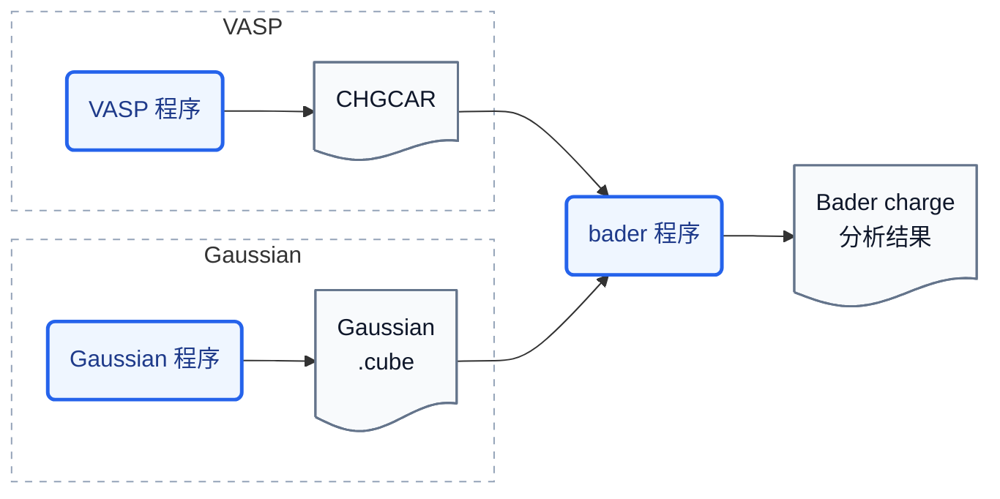
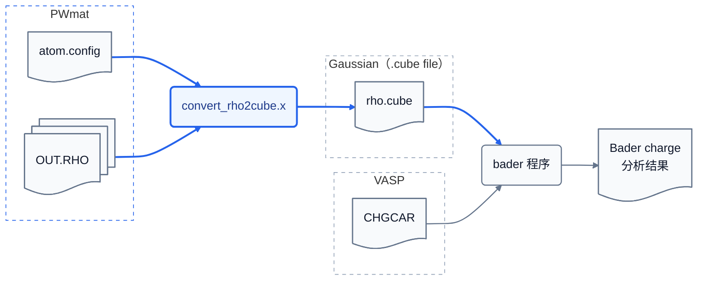

# bader-tools

`bader-tools` 是一组面向 PWmat 电荷密度的格式转换和辅助工具，用于衔接 PWmat 与 Henkelman 课题组的 `bader` 程序。

PWmat 的 `OUT.RHO` 是 Fortran 顺序非格式化文件，其中没有完整的原子结构信息，不能直接交给 `bader`。本项目的主程序 `convert_rho2cube.x` 从 PWmat 原子结构文件读取晶格和原子坐标，从一个或多个 `OUT.RHO` 读取并加权组合电荷密度，最后写成 `bader` 支持的 Gaussian cube 文件。它可以处理普通计算、`SPIN=2` 的两个自旋通道以及密度差。

对于只包含赝价电子密度的计算，本项目还提供一条可选的芯电子参考密度流程：重新运行生成 UPF 的 ONCVPSP 输入，提取球对称芯电子密度，再由 `convert_rho2cube.x` 生成 `rho.ref.cube`，供 `bader rho.cube -ref rho.ref.cube` 使用。这样由“价电子 + 芯电子”参考密度划分 Bader volume，但仍对原始价电子密度积分。

`bader` 和 ONCVPSP 是外部程序，不包含在本仓库中。普通格式转换不依赖 ONCVPSP；只有制作芯电子参考密度时才需要它。

## 工作流

### `bader` 程序的工作流

`bader` 可以直接读取 VASP 的 `CHGCAR`，也可以读取 Gaussian cube 格式的电荷密度。它根据输入密度划分 Bader volume、积分各区域的电子数，并输出 Bader charge 分析结果。



### 本项目如何适配 PWmat

PWmat 的 `OUT.RHO` 不是 `bader` 原生支持的输入格式，而且其中不包含完整的原子结构信息。本项目从 PWmat 原子结构文件与 `OUT.RHO` 读取所需数据，由 `convert_rho2cube.x` 转换成上图中的 Gaussian cube 格式，再交给原有的 `bader` 程序分析。



因此，`convert_rho2cube.x` 是格式和数据适配程序，不替代 `bader` 本身：前者负责读取、检查和组合 PWmat 数据并写出 `rho.cube`，后者负责 Bader volume 划分和电荷积分。

## 编译与测试

需要 GNU Make 和 Fortran 编译器；默认使用 `gfortran`：

```bash
make
make test
```

编译后的主程序位于：

```text
build/convert_rho2cube.x
```

可以通过 `FC`、`FFLAGS`、`LDFLAGS` 和 `LDLIBS` 覆盖默认构建参数，例如：

```bash
make FC=gfortran FFLAGS='-O3 -Wall'
```

清理主程序或测试构建产物：

```bash
make clean
make clean-tests
```

## 安装

默认安装到 `$HOME/.local/bin`：

```bash
make install
```

也可以指定安装前缀或可执行文件目录：

```bash
make PREFIX=/path/to/prefix install
make BINDIR=/path/to/bin install
```

安装目标包括：

- `convert_rho2cube.x`
- `run_oncvpsp_from_upf.sh`
- `extract_oncv_corecharge.sh`

请确保安装目录位于 `PATH` 中。

## 快速开始

假设当前 PWmat 计算目录中包含原子结构文件和 `OUT.RHO`，先转换为 cube：

```bash
/path/to/bader-tools/build/convert_rho2cube.x \
  -a atom.config \
  -r OUT.RHO \
  -o rho.cube
```

`-a` 后应填写当前计算实际使用的 PWmat 原子结构文件；文件名一般是 `atom.config`, 可能需要根据 `REPORT` 中记录的 `IN.ATOM` 确认。
如果是弛豫计算, 应该使用弛豫结果 `final.config`.

然后运行外部 `bader` 程序：

```bash
bader rho.cube
```

主要结果写入 `ACF.dat`。

共线自旋极化（`SPIN=2`）计算需要把两个自旋通道直接相加：

```bash
/path/to/bader-tools/build/convert_rho2cube.x \
  -a atom.config \
  -r OUT.RHO \
  -r OUT.RHO_2 \
  -o rho.cube
bader rho.cube
```


### 高级用法：芯电子参考密度

对于只含赝价电子密度的计算，可以额外构造“价电子 + 芯电子”参考密度，并执行 `bader rho.cube -ref rho.ref.cube`，以参考密度划分 Bader volume、以原始价电子密度积分。如果对这种方法感兴趣，请参阅[芯电子参考密度的理论与实践指导](docs/corecharge_reference.md)，其中说明了采用该方法的原因、近似的物理含义、ONCVPSP 补丁以及芯电子密度的生成和验证流程。

命令行参数、密度差和辅助脚本的完整说明见[代码使用说明](docs/code-usages.md)。Bader 参数与输出解释见[Bader 程序使用说明](note/bader-usage.md)。
