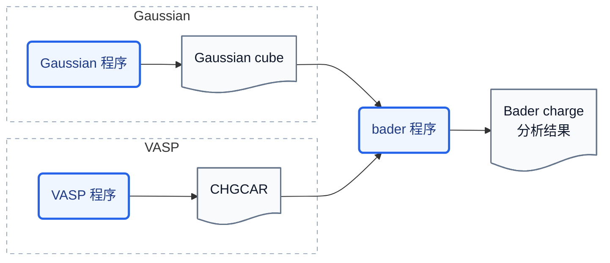
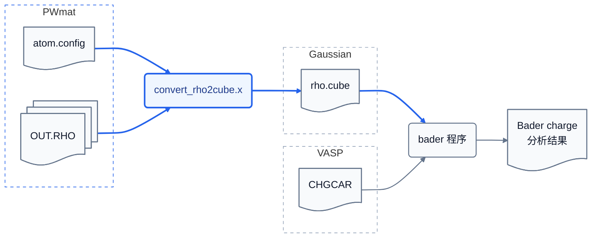

# bader-tools

`bader-tools` 是一套适配工具, 使得 PWmat 电荷密度输出可以被  Henkelman 课题组的 `bader` 程序分析。

## 工作流

### `bader` 程序的工作流

`bader` 可以直接读取 VASP 的 `CHGCAR`，也可以读取 Gaussian cube 格式的电荷密度。它根据输入的电荷密度划分 Bader 体积（Bader volume），对各区域内的电子数进行积分，并输出 Bader 电荷分析等结果。



### 本项目如何适配 PWmat

本项目从 PWmat 原子结构文件和 `OUT.RHO` 中读取所需数据，通过 `convert_rho2cube.x` 将其转换为上图中的 Gaussian cube 格式，再交由 `bader` 程序分析。



## 编译与安装

编译需要 GNU Make 和 Fortran 编译器，默认使用 `gfortran`：

```bash
make
```

程序默认安装到 `$HOME/.local/bin`：

```bash
make install
```

也可以指定安装前缀或可执行文件目录：

```bash
make PREFIX=/path/to/prefix install
make BINDIR=/path/to/bin install
```

安装目标包括：

- `convert_rho2cube.x`
- `run_oncvpsp_from_upf.sh`
- `extract_oncv_corecharge.sh`

请确保安装目录已加入 `PATH`。

## 快速开始

假设当前 PWmat 计算目录中包含原子结构文件和 `OUT.RHO`，可先将电荷密度转换为 cube 格式：

```bash
convert_rho2cube.x -a atom.config -r OUT.RHO -o rho.cube
```

`-a` 后应指定当前计算实际使用的 PWmat 原子结构文件。该文件通常为 `atom.config`，应通过 `REPORT` 中记录的 `IN.ATOM` 确认；对于弛豫计算，应使用弛豫后的结构文件 `final.config`。

转换完成后，运行外部 `bader` 程序：

```bash
bader rho.cube
```

`bader` 程序的使用方法详见 [bader-usage.md](note/bader-usage.md)。

对于共线自旋极化（`SPIN=2`）计算，需要将两个自旋通道相加：

```bash
convert_rho2cube.x \
  -a atom.config \
  -r OUT.RHO \
  -r OUT.RHO_2 \
  -o rho.cube
bader rho.cube
```

## 高级使用方法：全电子参考密度修正

在采用冻结芯近似的赝势计算中，输出的电荷密度通常不包含芯电子，因而可能影响 Bader 体积的划分。问题背景及 PWmat 下的解决思路参见 [core-rho-correction.md](note/core-rho-correction.md)，具体操作流程参见 [corecharge_reference.md](docs/corecharge_reference.md)。
