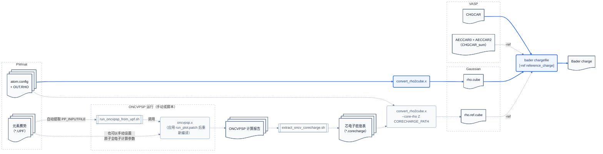

# 为 Bader 分析构造近似全电子参考密度

本文介绍如何利用 ONCVPSP 的原子全电子计算数据，为 PWmat 模守恒赝势计算输出的赝价电子电荷密度（`OUT.RHO`）补充芯电子密度，并生成供 `bader -ref` 使用的参考密度。

这里的参考密度由“赝价电子密度 + 芯电子密度”构成，并不是严格重建的全电子密度。`bader` 使用它划分 *Bader volume*，但仍在原始赝价电子密度上积分。有关这一近似的动机，参见 [core-rho-correction.md](../note/core-rho-correction.md)；各工具的完整命令行说明见 [code-usages.md](code-usages.md)。

## 流程概览



## 最短工作流

这套方法的本质是：从生成赝势时的原子全电子计算中取得芯电子密度，将其叠加到 PWmat 的赝价电子密度上作为划分参考；`bader` 仍在未叠加芯电子的赝价电子密度上积分。

虽然 `--core-rho` 也接受自定义的模型密度，但正式分析建议按照以下三步生成产生更真实的 `.corecharge` 文件。后文第 1、2、3 节将依次说明各步的原理、操作方法和注意事项。

1. 应用 [`run_plot.patch`](../oncvpsp-patch/run_plot.patch)，重新编译 ONCVPSP，使其输出完整的 `!R` 芯电子密度数据。
2. 从 PWmat 计算所用的 UPF 赝势中提取原子计算输入，重新运行 ONCVPSP。
3. 从 ONCVPSP 计算报告中提取 `!R` 数据，生成并检查 `.corecharge` 文件。

以下以 Na 为例，展示这三个步骤以及后续 Bader 分析如何串联：

```bash
tool/run_oncvpsp_from_upf.sh Na.UPF \
  --oncvpsp /path/to/oncvpsp/bin \
  -o Na.oncvpsp.stdout

tool/extract_oncv_corecharge.sh Na.oncvpsp.stdout \
  --tag R \
  --source-upf Na.UPF \
  -o Na.corecharge
```

然后用相同的 PWmat 输入分别生成赝价电子密度和参考密度：

```bash
convert_rho2cube.x \
  -a atom.config \
  -r OUT.RHO \
  -o rho.cube

convert_rho2cube.x \
  -a atom.config \
  -r OUT.RHO \
  -o rho.ref.cube \
  --core-rho 11 Na.corecharge 10

bader rho.cube -ref rho.ref.cube
```

其中，`11` 是 Na 的原子序数，`10` 是可选的预期芯电子数；这些参数的含义和检查方法见第 3 节。

## 为什么选择 ONCVPSP

生成赝势之前，赝势生成程序需要先求解参考原子的全电子问题，因此内部已经具备所需的原子 DFT 全电子计算模块。要重现与赝势一致的芯电子密度，该模块至少需要以下信息：

1. 交换关联泛函，如 LDA 或 PBE。
2. 参考原子的电子配置，如 $1s^2 2s^2 2p^6 3s^1$。
3. 价态与芯态的划分，如把 $1s^2 2s^2 2p^6$ 视为芯电子。

PWmat 提供的许多 UPF 赝势由 ONCVPSP 生成。此类文件通常在 `<PP_INPUTFILE>` 标签中保留原始 ONCVPSP 输入，其中已经包含上述信息。因此，我们认为这将是带来便利最多的选择。

## 1. 应用补丁并重新编译 ONCVPSP

ONCVPSP 原有的 `!r` 数据块用于绘图，其中的径向网格经过稀疏化和截断，芯电子密度还可能被裁剪。这样的数据适合绘图，却可能无法正确完成参考电荷计算，不宜引入通用方法当中。

本项目提供的 [`run_plot.patch`](../oncvpsp-patch/run_plot.patch) 会新增 `!R` 数据块，输出未经绘图逻辑稀疏化或裁剪的完整芯电子密度。正式分析应使用补丁版 ONCVPSP，并在提取时指定 `--tag R`，避免意外回退到 `!r` 数据。

ONCVPSP 的依赖和构建方式会随版本与计算环境变化。如果不熟悉相关工具，可以把下面的提示词交给 coding agent。使用前，应先替换其中的路径占位符。

<details>
<summary>展开用于编译 ONCVPSP 的提示词</summary>

```text
请在当前计算机上为我编译应用过补丁的 ONCVPSP，并在得到我的明确授权后安装。我需要
`oncvpsp.x`；如果当前源码支持，也构建非相对论和全相对论版本。补丁应让程序在标准输出中
额外写出未被绘图逻辑裁剪的 `!R` 径向芯电子密度数据。

资源和路径：

- ONCVPSP 官方仓库：https://github.com/oncvpsp/oncvpsp
- Hamann 的项目网站也包含 ONCVPSP 源码包：http://www.mat-simresearch.com/
- libxc 下载页：https://libxc.gitlab.io/download/
- libxc 官方仓库：https://gitlab.com/libxc/libxc
- 补丁：`<BADER_TOOLS>/oncvpsp-patch/run_plot.patch`
- 可写的工作根目录：`<WORK_ROOT>`
- 安装前缀：`<INSTALL_PREFIX>`
- 可选的现有构建脚本或参考安装：`<REFERENCE_BUILD>`

请直接完成安全且无须额外授权的工作，不要只给我一份泛化教程。按以下要求执行：

1. 只读检查操作系统和架构、C/Fortran 编译器、CMake/Make/Ninja、`module`、
   `pkg-config`，以及现有的 BLAS/LAPACK、MKL/OpenBLAS 和 libxc。阅读所选 ONCVPSP 版本的
   README、`Makefile` 和 `CMakeLists.txt`；如果给了 `<REFERENCE_BUILD>`，也检查其构建参数。
   简要报告可用环境、拟采用的方案和兼容性风险，然后继续实施。

2. 优先复用现有编译器、module 和数学库，并保证 C、Fortran、BLAS/LAPACK 和 libxc
   的编译器 ABI 兼容。根据当前源码和本机环境选择 Makefile 或 CMake。只在确有需要时
   另行编译 libxc；如果编译，必须启用 ONCVPSP 需要的 Fortran 接口。

3. 下载、解压、修改源码、构建和中间产物只能放在 `<WORK_ROOT>` 中新建的独立目录，
   只安装到 `<INSTALL_PREFIX>`。不要修改原始补丁、其他项目、shell 启动文件、系统目录或
   全局 module 目录，也不要覆盖用途不明的文件。只从上述官方来源下载，并记录版本、commit
   或校验和。不得自行使用 `sudo`、系统包管理器或管理员权限；如果确实需要，先说明原因、
   命令和影响，等待授权。

4. 先运行 `git apply --check <patch>`，成功后再应用补丁并检查 diff。如果失败，不要用 fuzz
   强行应用。请说明失败原因和原补丁的语义；能确认语义等价时，做最小化手工迁移并展示 diff，
   否则停止修改并说明需要我决定的问题。

5. 使用独立的 out-of-source build 目录和适合正式运行的优化配置。若链接非系统路径中的共享库，
   优先设置合理的 RPATH。尽量使安装后的程序无须手动设置 `LD_LIBRARY_PATH`；如果做不到，
   明确说明运行时必需的环境。

6. 编译完成后至少验证：动态依赖中没有 `not found`；上游代表性测试或示例可以运行；
   一个含芯电子的输入会产生格式正确的 `!R` 数据。如果
   `<BADER_TOOLS>/tool/extract_oncv_corecharge.sh` 可用，还要实际提取芯电子密度表并核对积分。
   如果新增的 `!R` 行导致上游文本对比测试失败，要将它与计算本身失败区分开。

7. 完成构建和验证后，在任何安装行为之前提交精确的安装计划，包括安装前缀、命令、文件改动、
   冲突、环境接入方式、运行时依赖和回退方法，并明确询问我是否授权。即使已经填写
   `<INSTALL_PREFIX>`，也不表示已经授权。获得授权后再执行获批的安装操作，并验证安装结果。

8. 最后报告实际使用的版本或 commit、编译器和库、关键构建选项、补丁方式、安装路径、
   可执行文件、测试结果、运行命令和剩余限制。若中途失败，保留 `<WORK_ROOT>` 中的现场，
   报告错误位置、诊断和建议的下一步，不要把未验证的构建声称为成功。
```

</details>

## 2. 恢复输入并运行 ONCVPSP

如果 UPF 由 ONCVPSP 生成，其中通常包含 `<PP_INPUTFILE>` 标签，记录生成该赝势时使用的输入。把标签内的内容提取为输入文件，即可重新运行 ONCVPSP。

还需要根据 UPF 的相对论元数据选择对应的可执行文件。`<PP_HEADER>` 中的 `relativistic` 属性通常为 `scalar`、`full` 或 `nonrelativistic`，分别表示标量相对论、全相对论和非相对论计算。不同 ONCVPSP 版本的可执行文件名称可能不同，例如全相对论版本可能名为 `oncvpspr.x` 或 `oncvpsp_r.x`。

`tool/run_oncvpsp_from_upf.sh` 会提取 `<PP_INPUTFILE>`，综合 UPF 的相对论和自旋—轨道耦合元数据，并选择相应的 ONCVPSP 程序。以下仍以 Na 为例：

```bash
tool/run_oncvpsp_from_upf.sh Na.UPF \
  --oncvpsp /path/to/oncvpsp/bin \
  -o Na.oncvpsp.stdout
```

这个命令把 ONCVPSP 的完整标准输出保存为 `Na.oncvpsp.stdout`。后续步骤从该报告中提取芯电子密度。`--oncvpsp` 可以省略；脚本按以下优先级查找可执行文件：

1. 命令行参数 `--oncvpsp DIR` 指定的安装目录。
2. 环境变量 `ONCVPSP_DIR` 指定的安装目录。
3. `PATH` 中的相应可执行文件。

也可以使用 `--oncvpsp FILE` 强制指定某个可执行文件；此时，脚本对 UPF 类型的推断只用于提示，不再决定所用程序。

### UPF 中没有 `<PP_INPUTFILE>` 时

如果 UPF 没有保留原始输入，只能手工构造 ONCVPSP 输入。可以从 ONCVPSP 的测试目录或其他 UPF 文件中复制一份模板，例如：

```text
# ATOM AND REFERENCE CONFIGURATION
# atsym  z   nc   nv     iexc    psfile
  Si 14.00    3    2       3      upf
#
#   n    l    f
    1    0    2.00
    2    0    2.00
    2    1    6.00
    3    0    2.00
    3    1    2.00
#
# PSEUDOPOTENTIAL AND OPTIMIZATION
......
```

这个示例只展示输入开头的**全电子计算阶段**参数，后面还需要提供**赝离子化阶段**参数。所需的芯电子密度由全电子计算阶段决定；后续参数只须保证 ONCVPSP 能够正常完成计算，但不会改变已经确定的芯电子配置。

连续以 `#` 开头的行是注释或分隔行，程序会跳过。第一个数据行的字段含义如下：

| 字段 | 含义 |
| --- | --- |
| `atsym` | 最多包含 2 个字符的元素符号。该值会写入 UPF 的 `element` 等元数据，ONCVPSP 不检查它是否与 `z` 匹配。 |
| `z` | 核电荷数 $Z$，即元素的原子序数，而不是电子数；它决定核库仑势 $-Z/r$。 |
| `nc` | 后续电子配置中芯态的行数。 |
| `nv` | 后续电子配置中价态的行数。 |
| `iexc` | 原子 DFT 计算所用交换关联泛函的编号。 |
| `psfile` | 赝势输出格式：ABINIT 的 `psp8`、Quantum ESPRESSO 的 `upf`，或同时输出两者的 `both`。 |

随后，ONCVPSP 连续读取 `nc + nv` 行电子配置：前 `nc` 行是芯轨道，后 `nv` 行是价轨道。每行的 `n`、`l`、`f` 分别表示主量子数、角动量量子数和轨道占据数。

所有占据数之和不必等于核电荷数。ONCVPSP 要求

$$
\sum_i f_i \leq Z.
$$

等号对应中性参考原子，小于 $Z$ 对应正离子参考配置；大于 $Z$ 时，程序会把它判定为负离子并停止。尽管模守恒条件旨在提高赝势对不同化学环境的可迁移性，参考电子配置仍可能影响散射性质，因此应尽量使用生成目标赝势时的原始输入。

`f` 可以是实数。真实体系中的电子数是整数，但 LDA/GGA 近似下的原子计算允许使用分数占据。输出回显还可能在 `(n, l, f)` 后附加 `energy (Ha)`；这是 ONCVPSP 求解得到的本征值，不是需要手工提供的输入参数。

ONCVPSP 内置的常用 `iexc` 编号如下：

| `iexc` | 交换关联泛函 | 类型 |
| ---: | --- | --- |
| `3` | Perdew–Zunger 对 Ceperley–Alder 数据的参数化 | LDA |
| `4` | Perdew–Burke–Ernzerhof（PBE） | GGA |

使用这些内置编号时，ONCVPSP 调用自身的泛函实现，编译时不需要链接 libxc。负数 `iexc` 按 `-XXXCCC` 编码调用 libxc，其中 `XXX` 和 `CCC` 分别是 libxc 的交换泛函和关联泛函编号。例如，`-001009` 表示 Perdew–Zunger/Ceperley–Alder LDA，`-101130` 表示 PBE。UPF 写出器只能翻译其中一部分编号。

## 3. 提取并检查芯电子密度

按照 ONCVPSP 的习惯，`!r` 和 `!R` 数据块中的芯电子密度包含 $4\pi$ 因子。`tool/extract_oncv_corecharge.sh` 会提取径向数据并除以 $4\pi$，生成符合 `convert_rho2cube.x --core-rho` 要求的两列表格；不要再次手工除以 $4\pi$。

以下仍以 Na 为例。推荐显式要求完整的 `!R` 数据：

```bash
tool/extract_oncv_corecharge.sh Na.oncvpsp.stdout \
  --tag R \
  --source-upf Na.UPF \
  -o Na.corecharge
```

`--tag R` 要求报告中存在补丁版 ONCVPSP 输出的完整 `!R` 数据，不允许回退到为绘图裁剪过的 `!r` 数据。脚本会检查数据格式和半径单调性，计算并报告芯电子积分，并在验证成功后才发布输出文件。

### 核对芯电子数

`convert_rho2cube.x --core-rho` 对 `.corecharge` 文件的格式要求和读取方式见 [code-usages.md](code-usages.md) 的“芯电子密度表格式”一节。这里主要检查提取结果是否与实际使用的赝势一致。

提取脚本报告的径向积分应满足

$$
4\pi\int_0^\infty r^2\rho_\mathrm{core}(r)\,\mathrm{d}r=N_\mathrm{core}.
$$

应核对脚本报告的积分是否与所用赝势的价、芯电子划分一致。对原子序数为 $Z$、赝势价电子数为 $z_\mathrm{valence}$ 的元素，预期芯电子数通常为

$$
Q_\mathrm{core} = Z - z_\mathrm{valence}.
$$

把该值作为 `--core-rho` 的可选 `QCORE` 参数，可以让 `convert_rho2cube.x` 再次检查芯电子密度表。以 Na 为例，原子序数是 `11`；如果所用赝势包含 1 个价电子，则 `QCORE = 11 - 1 = 10`：

```text
--core-rho 11 Na.corecharge 10
```

省略 `QCORE` 不影响参考密度的生成，但程序不会比较预期芯电子数。该检查只会给出警告；最终仍需由使用者确认密度表与实际赝势匹配。

### 生成参考密度并运行 Bader 分析

`--core-rho Z CORECHARGE_PATH [QCORE]` 对所有原子序数为 `Z`、位置为 $\{\boldsymbol{\tau}_i\}$ 的原子叠加

$$
\sum_i \rho_\mathrm{core}\bigl(\boldsymbol{r}-\boldsymbol{\tau}_i\bigr),
$$

并计入晶胞的周期像。体系包含多种元素时，可以只为你认为值得修正的元素们指定一次 `--core-rho`。

使用相同的 PWmat 数据运行两次 `convert_rho2cube.x`：

```bash
convert_rho2cube.x \
  -a atom.config \
  -r OUT.RHO \
  -o rho.cube

convert_rho2cube.x \
  -a atom.config \
  -r OUT.RHO \
  -o rho.ref.cube \
  --core-rho 11 Na.corecharge 10
```

两次调用的 `-a`、`-r` 及其权重必须完全一致：第一次生成赝价电子密度 `rho.cube`；第二次额外叠加芯电子密度，生成参考密度 `rho.ref.cube`。

最后运行：

```bash
bader rho.cube -ref rho.ref.cube
```

`rho.ref.cube` 决定空间划分，`ACF.dat` 中的电子数仍来自 `rho.cube`。
