# 为 Bader 分析构造近似全电子参考密度

本文介绍如何利用 ONCVPSP 的全电子计算数据, 对 PWmat 在模守恒赝势计算下输出的 (赝价电子) 电荷密度文件 (`OUT.RHO`) 进行全电子修正,
以支持 `bader` 分析 VASP `CHGCAR` 时, 类似引入全电子电荷密度文件 `AECCAR` 辅助 Bader volume 划分 (`bader <CHGCAR> -ref <AECCAR>`) 的功能.

该功能所解决的问题和解决方案的讨论可以查看[core-rho-correction.md](../note/core-rho-correction.md).

## tldr

```mermaid
flowchart LR
    subgraph pwmat["PWmat"]
        direction TB
        pwmat_inputs@{ shape: docs, label: "atom.config<br/>+ OUT.RHO" }
        upf@{ shape: doc, label: "ele.UPF" }
    end

    subgraph gaussian["Gaussian（.cube file）"]
        direction TB
        rho_cube@{ shape: doc, label: "rho.cube" }
        rho_ref_cube@{ shape: doc, label: "rho.ref.cube" }
    end

    subgraph vasp["VASP"]
        chgcar@{ shape: doc, label: "CHGCAR" }
        aeccar@{ shape: doc, label: "AECCAR" }
    end

    %% 此分组表示两种运行方式; UPF 分别直连脚本和 ONCVPSP 程序.
    subgraph oncv_tools["ONCVPSP 运行（手动 / 脚本）"]
        direction TB
        run_oncv[["run_oncvpsp_from_upf.sh"]]
        oncvpsp("oncvpsp.x<br/>（run_plot.patch 后重新编译）")
    end

    %% 节点分为三类: 文件（单张或叠层文档, Mermaid 11.3+）、主要程序（圆角矩形）、脚本（双竖线矩形）; 虚线框用于分组.
    %% 普通操作: 转换待分析密度, 或直接读取 CHGCAR.
    pwmat_inputs --> convert_cube("convert_rho2cube.x")
    convert_cube --> rho_cube
    rho_cube --> bader("bader chargefile<br/>[-ref reference_charge]")
    chgcar --> bader
    bader --> charge@{ shape: doc, label: "Bader charge" }

    %% Advance: VASP 使用 AECCAR; PWmat 由配套的 OUT.RHO、atom.config 与芯电荷表生成参考密度.
    aeccar -.->|"-ref"| bader
    %% 手动方式可独立准备输入; 脚本是自动准备输入并运行同一补丁版程序的可选捷径.
    upf -.->|"自动提取 PP_INPUTFILE"| run_oncv
    upf -.->|"也可以手动设置<br/>全电子计算参数"| oncvpsp
    run_oncv -.->|"调用"| oncvpsp
    oncvpsp -.-> oncv_report@{ shape: doc, label: "ONCVPSP 计算报告" }
    oncv_report -.-> extract_core[["extract_oncv_corecharge.sh"]]
    extract_core -.-> corecharge@{ shape: docs, label: "ele.corecharge" }
    pwmat_inputs -.-> convert_ref("convert_rho2cube.x<br/>--core-rho Z ele.corecharge")
    corecharge -.-> convert_ref
    convert_ref -.-> rho_ref_cube
    rho_ref_cube -.->|"-ref"| bader

    %% 路线颜色表示操作层次; 所有文件统一使用中性样式.
    classDef basic fill:#eff6ff,stroke:#2563eb,color:#1e3a8a,stroke-width:2.5px
    classDef advanced fill:#f8fafc,stroke:#94a3b8,color:#475569,stroke-width:1.5px
    classDef neutral fill:#f8fafc,stroke:#64748b,color:#0f172a,stroke-width:1.5px
    class convert_cube,bader basic
    class oncvpsp,run_oncv,extract_core,convert_ref advanced
    class pwmat_inputs,upf,rho_cube,rho_ref_cube,chgcar,aeccar,oncv_report,corecharge,charge neutral
    style pwmat fill:#ffffff,stroke:#94a3b8,stroke-dasharray:5 5
    style gaussian fill:#ffffff,stroke:#94a3b8,stroke-dasharray:5 5
    style vasp fill:#ffffff,stroke:#94a3b8,stroke-dasharray:5 5
    style oncv_tools fill:#ffffff,stroke:#94a3b8,stroke-dasharray:5 5
    linkStyle 0,1,2,3,4 stroke:#2563eb,stroke-width:2.5px
    linkStyle 5,6,7,8,9,10,11,12,13,14,15 stroke:#64748b,stroke-width:1.25px
```


## 操作流程

使用 `convert_rho2cube.x` 将 PWmat 的电荷密度转成 bader 支持的输入文件格式, 使用

```bash
convert_rho2cube.x -a atom.config -r OUT.RHO -o <rho.cube>
bader rho.cube
```

`convert_rho2cube.x` 支持传入芯电子电荷密度数据, 以生成一个 "全电子"电荷密度文件, 使用

```bash
convert_rho2cube.x -a atom.config -r OUT.RHO -o rho.ref.cube \
    --core-rho Z_ELE1 ele1.corecharge \
    --core-rho Z_ELE2 ele2.corecharge
bader rho.cube -ref rho.ref.cube
```

`Z_ELE` 是原子序号, 与 `atom.config` 中描述原子种类和位置的数据对应; `ele.corecharge` 也应该视情况替换成真实文件名.
`ele.corecharge` 的文件内容是两列数据, 第一列是半径 $r$, 第二列是球对称径向函数 $\rho_\mathrm{core}(r)$.
`--core-rho Z_ELE ele.corecharge` 做的事, 就是对所有原子序号是 `Z_ELE` 的位置 $\mathbf{\tau_i}$ , 叠加一个 $\rho_\mathrm{core}(\mathbf{r}-\mathbf{\tau_i})$, 考虑晶胞周期性.

`ele.corecharge` 可以是自造的模型芯电子电荷密度, 但是我们更建议使用以下流程使用真实的芯电子电荷密度.

1. 下载 oncvpsp 源码, 应用 [run_plot.patch](../oncvpsp-patch/run_plot.patch) 代码补丁, 编译 oncvpsp
2. 从 PWmat 计算中的输入赝势文件提取原子全电子计算配置信息, 输入 oncvpsp 并运行
3. 提取 oncvpsp 标准输出中, `!R` 数据段芯电子电荷密度, 经过数据转换, 产生 `ele.corecharge` 文件

### "为什么选择 oncvpsp? "

我们需要一个可以进行原子的 DFT 全电子计算的程序, 从中获得芯电子的电荷密度数据.
赝势生成软件是一个好选择. 因为原子全电子计算是制造赝势的前置动作, 所以它们内部一定包含  DFT 原子全电子计算模块.

我们需要告诉这个计算模块

1. 使用的泛函 (如, LDA/PBE)
2. 电子配置 (如, $1s^2 2s^2 2p^6 3s^1$)
3. 把哪些能级当作芯电子能级 (如, 把 $1s^2 2s^2 2p^6$ 当作芯电子), 以便输出 "芯电子电荷密度"

目前 PWmat 官网提供的 UPF 赝势文件大多由 ONCVPSP 生成,
这类文件头通常包含一个  `<PP_INPUTFILE>` 标签, 这是 oncvpsp 的输入参数回写, 自然包含上面三个信息.
理想情况下只需要拷贝  `<PP_INPUTFILE>` 里面的内容, 输入给 oncvpsp, 就可以从 oncvpsp 输出 `!r` 数据块获悉芯电子电荷密度.

我想这是最简单的做法.

### 1. 应用补丁, 重新编译 `oncvpsp.x`

我们注意到 `!r` 数据块内的径向芯电子电荷密度仅服务于绘图, 经过了裁剪.
考虑到作为一个通用的修正方法, 使用以上裁剪的数据可能会破坏方法的有效性,
我们建议通过添加程序补丁 [run_plot.patch](../oncvpsp-patch/run_plot.patch) , 重新编译 oncvpsp, 输出并使用记录完整芯电子电荷密度新的 `!R` 数据块.

oncvpsp 源码涉及很多依赖, 编译起来有一些麻烦,
再加上大家的计算机环境各不相同, 写一份适合不同环境和需求的编译指导手册太难了.
好在 LLM 大人精通这件事, 可以直接请 coding agent 帮忙:

下面提示词中的路径替换为自己的路径, 然后整段复制给 coding agent:

```text
请在当前计算机上为我编译打过补丁的 ONCVPSP, 并在得到我的明确授权后安装. 我需要
`oncvpsp.x`; 如果当前源码支持, 也构建非相对论和全相对论版本. 补丁应让程序在标准输出中
额外写出未被绘图逻辑裁剪的 `!R` 径向芯电荷密度数据.

资源和路径:

- ONCVPSP 官方仓库: https://github.com/oncvpsp/oncvpsp
- Hamann 的项目网站也包含 ONCVPSP 源码包: http://www.mat-simresearch.com/
- libxc 下载页: https://libxc.gitlab.io/download/
- libxc 官方仓库: https://gitlab.com/libxc/libxc
- 补丁: `<BADER_TOOLS>/oncvpsp-patch/run_plot.patch`
- 可写的工作根目录: `<WORK_ROOT>`
- 安装前缀: `<INSTALL_PREFIX>`
- 可选的现有构建脚本或参考安装: `<REFERENCE_BUILD>`

请直接完成安全、无需额外授权的工作, 不要只给我一份泛化教程. 按以下要求执行:

1. 先只读检查操作系统和架构、C/Fortran 编译器、CMake/Make/Ninja、`module`、
   `pkg-config`, 以及现有的 BLAS/LAPACK、MKL/OpenBLAS 和 libxc. 阅读所选 ONCVPSP 版本的
   README、`Makefile` 和 `CMakeLists.txt`; 如果给了 `<REFERENCE_BUILD>`, 也只读检查其构建参数.
   简要报告可用环境、拟采用的方案和兼容性风险, 然后继续实施.

2. 优先复用现有编译器、module 和数学库, 并保证 C、Fortran、BLAS/LAPACK 和 libxc
   的编译器 ABI 兼容. 根据当前源码和本机环境选择 Makefile 或 CMake, 不要凭记忆写死选项.
   只在确有需要时另行编译 libxc; 如果编译, 必须启用 ONCVPSP 需要的 Fortran 接口.

3. 下载、解压、改源码、构建和中间产物只能放在 `<WORK_ROOT>` 中新建的独立目录,
   只安装到 `<INSTALL_PREFIX>`. 不要修改原始补丁、其他项目、shell 启动文件、系统目录或
   全局 module 目录, 也不要覆盖用途不明的文件. 只从上述官方来源下载, 并记录版本、commit
   或校验和. 不得自行使用 `sudo`、系统包管理器或管理员权限; 如果确实需要, 先向我说明
   原因、命令和影响, 等待授权.

4. 先运行 `git apply --check <patch>`, 成功后再应用补丁并检查 diff. 如果失败,
   不要用 fuzz 强行应用. 请对照补丁和新源码, 说明失败原因、原补丁改了什么,
   以及在当前版本中应如何实现. 如果能确认语义等价, 做最小化手工迁移并展示 diff;
   如果无法确认, 停止修改并说明需要我决定的问题.

5. 使用独立的 out-of-source build 目录和适合正式运行的优化配置. 若链接 MKL
   或其他非系统路径中的共享库, 优先设置合理的 RPATH; 仅在上游和库许可时考虑静态链接.
   尽量使安装后的程序无需手动设置 `LD_LIBRARY_PATH` 或重新加载整套编译环境;
   如果做不到, 明确说明运行时必需的环境.

6. 只读检查用户现有的软件组织方式, 包括 `module`/`MODULEPATH`、`PATH`
   中的用户级 `bin` 目录、常用安装前缀、已有的版本目录, 以及符号链接、包装脚本或
   环境脚本的命名习惯. `<INSTALL_PREFIX>` 明确可用时以它为准; 如果它未替换、不可写,
   或与明确的现有约定冲突, 列出候选方案和影响并一次性询问我. 若现有方式唯一、可写且
   与安装前缀一致, 则在安装计划中沿用它: 例如拟创建本地 modulefile、在既有用户
   `bin` 中添加不覆盖现有文件的链接, 或按既有格式提供环境脚本. 如果没有现成组织方式,
   计划将安装内容自包含于 `<INSTALL_PREFIX>`, 并给出绝对路径调用方法和可选的局部环境脚本.
   不要计划修改 shell 启动文件、全局 `PATH` 或共享软件目录.

7. 编译完成后至少验证: 可执行文件的动态依赖中没有 `not found`; 上游的代表性测试或示例能运行;
   一个含芯电子的输入会产生格式正确的 `!R` 数据. 如果
   `<BADER_TOOLS>/tool/extract_oncv_corecharge.sh` 可用, 还要实际提取 core-charge 文件,
   并核对其积分芯电子数. 对构建生成的每个 ONCVPSP 变体做基本运行检查.
   如果补丁新增的 `!R` 行造成上游文本对比测试失败, 要将它与计算本身失败区分开.

8. 完成构建和上述验证后, 在任何安装行为之前向我提交精确的安装计划: 安装前缀、
   将执行的命令、将新建或更改的目录和文件、与现有内容的冲突、环境接入方式、
   运行时依赖和回退方法, 然后明确询问我是否授权执行. 即使 `<INSTALL_PREFIX>` 已经填写,
   也不代表已经授权; 没有得到我的明确肯定答复也不视为默认同意. 在授权前不得运行
   `cmake --install`、`make install`, 不得向安装前缀复制或移动文件, 也不得创建符号链接、
   modulefile、包装脚本或环境脚本. 只在获得授权后执行获批的范围, 并在安装后验证
   可执行文件和环境接入方式.

9. 最后报告实际使用的版本/commit、编译器和库、关键构建选项、补丁方式、安装路径、
   可执行文件、测试结果、运行及环境接入命令和剩余限制. 若中途失败, 保留 `<WORK_ROOT>` 中的现场,
   报告完整错误的位置、诊断和建议的下一步, 不要把未验证的构建声称为成功.
```


### 2. 制作输入文件, 运行 oncvpsp

如果我们使用的赝势 UPF 文件由 oncvpsp 生成, 文件中会包含 `<PP_INPUTFILE>` 标签, 记录运行 oncvpsp 时的输入信息.
提取其中的内容, 拷贝到一个输入文件供 oncvpsp 读取

此外, 你还需要查看这个赝势是考虑了什么相对论效应, 以选择使用哪个 oncvpsp 程序.
决定赝势中包含何种程度的相对论效应, 需要查看 <PP_HEADER> 中的   "relativistic" 属性, 可能的取值为 "scalar | full | nonrelativistic".
oncvpsp 包含三个程序 `oncvpsp.x`, `oncvpspr.x`, `oncvpspnr.x`,
吊诡的是, 看起来应该对应考虑了标量相对论效应, 考虑全相对论效应 (包含自旋轨道耦合) 和不考虑相对论效应的计算程序.
但是实际 `oncvpsp.x`, `oncvpspnr.x` 是一个程序, 都进行考虑标量相对论效应的计算.

`tool/run_oncvpsp_from_upf.sh` 脚本可以帮你从 UPF 中提取 `<PP_INPUTFILE>` 标签并识别 `relativistic` 属性, 选择正确的 oncvpsp 运行.
只需要提供给三个oncvpsp可执行文件存在的路径, `tool/run_oncvpsp_from_upf.sh` 会正确从中选择. 路径的指定方式是

1. `PATH` 环境变量
2. `ONCVPSP_DIR` 环境变量
3. 命令行 `run_oncvpsp_from_upf.sh --oncvpsp DIR`

逐个覆盖的. 也可以直接使用

4. 命令行 `run_oncvpsp_from_upf.sh --oncvpsp FILE` 强制指定所用的 oncvpsp 程序.


#### 如果 UPF 文件头没有 `<PP_INPUTFILE>` 标签
那就只好自己从头构造一个 oncvpsp 输入了.
一个输入长下面这样, 可以从 oncvpsp 源码测试目录或其他 UPF 文件中拷贝一份当模板:

```text
# ATOM AND REFERENCE CONFIGURATION
# atsym  z   nc   nv     iexc    psfile
  Si 14.00    3    2       3      upf
#
#   n    l    f
    1    0    2.00
    2    0    2.00
    2    1    6.00
    3    0    2.00
    3    1    2.00
#
# PSEUDOPOTENTIAL AND OPTIMIZATION
......
```

示例只展示了输入文件开头的**全电子计算阶段**参数, 后面还需要继续给出与**赝离子化**有关的参数,
由于我们需要的芯电子电荷密度在全电子计算阶段决定, 赝离子化阶段参数的设置只需要保证oncvpsp能正常运行, 不会对 `!R` 数据块结果产生影响.

示例各字段的含义如下:

连续以 `#` 开头的行是注释分隔行, 程序会跳过它们.

第一个数据行内容如下表

| 字段 | 含义 |
|---|---|
| `atsym` | 长度最多为 2 的元素符号. ONCVPSP 只检查它是否非空, 不检查它是否与 `z` 匹配. 它会被写入 UPF 的 `element` 等元数据. |
| `z` | 核电荷数 $Z$, 也就是元素的原子序数, 不是电子数. 它决定核库仑势 $-Z/r. |
| `nc` | 接下来输入的电子配置中, 芯态的行数. |
| `nv` | 接下来输入的电子配置中, 价态的行数. |
| `iexc` | 原子 DFT 计算使用的交换关联泛函编号. |
| `psfile` | 赝势输出格式: ABINIT`psp8` / QE `upf`/ `both`  |

接下来, oncvpsp 会连续读入 `nc+nv` 行记录. 前 `nc` 行被当作芯轨道, 后 `nv` 行被当作价轨道.
每行记录包含 `n` `l` `f`, 分别是主量子数, 角动量量子数和该轨道的电子占据数.
所有占据数的和不必等于 `z`. ONCVPSP 允许

$$
\sum_i f_i\leq Z.
$$

等号表示中性参考原子; 小于 $Z$ 表示正离子参考组态; 大于 $Z$ 会被程序判定为负离子并停止. 我们在理想中期望赝离子的散射行为与制作赝势时的电子配置无关, 模守恒条件也在努力保证这一点; 但是现实中还是会由差别, 有人会根据原子所处具体环境的电子配置生成自己的赝势.
`f` 可以是实数, 电子不能是分数个, 但是 LDA/GGA 近似下密度泛函允许分数占据.

除了 `(n,l,f)`, 你可能还会在这一行看到 `energy (Ha)`, 这是 ONCVPSP 求解后在输出回显中追加的本征值, 不是需要手工给出的输入参数.

ONCVPSP 的内置 `iexc` 编号对应的泛函为:

| `iexc` | 交换关联泛函 | 类型 |
|---:|---|---|
| `3` | Perdew--Zunger 对 Ceperley--Alder 数据的参数化 | LDA |
| `4` | Perdew--Burke--Ernzerhof (PBE) | GGA |

仅使用以上编号时, ONCVPSP 使用自带的泛函实现, 编译时不需要链接 libxc.
负数 `iexc` 则按 `-XXXCCC` 编码调用 libxc, 其中 `XXX` 和 `CCC` 分别是 libxc 的 exchange 和 correlation 泛函编号. 例如 `-001009` 表示 Perdew--Zunger/Ceperley--Alder LDA, `-101130` 表示 PBE. UPF 写出器只能翻译其中一部分编号.


### 3. 提取芯电子电荷密度数据

注意按照 oncvpsp 的习惯, 其输出的电荷密度 包含 $4\pi$ 因子, 从 `!r` 或 `!R` 提取的数据需要除以 $4\pi$ 才符合
`convert_rho2cube --core-rho` 的输入文件格式.

`tool/extract_oncv_corecharge.sh` 脚本可以帮你从 oncvpsp 的输出中提取并处理 oncvpsp 芯电子电荷密度.
