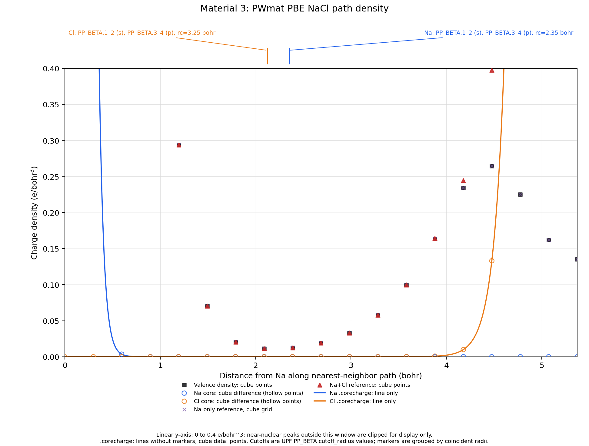
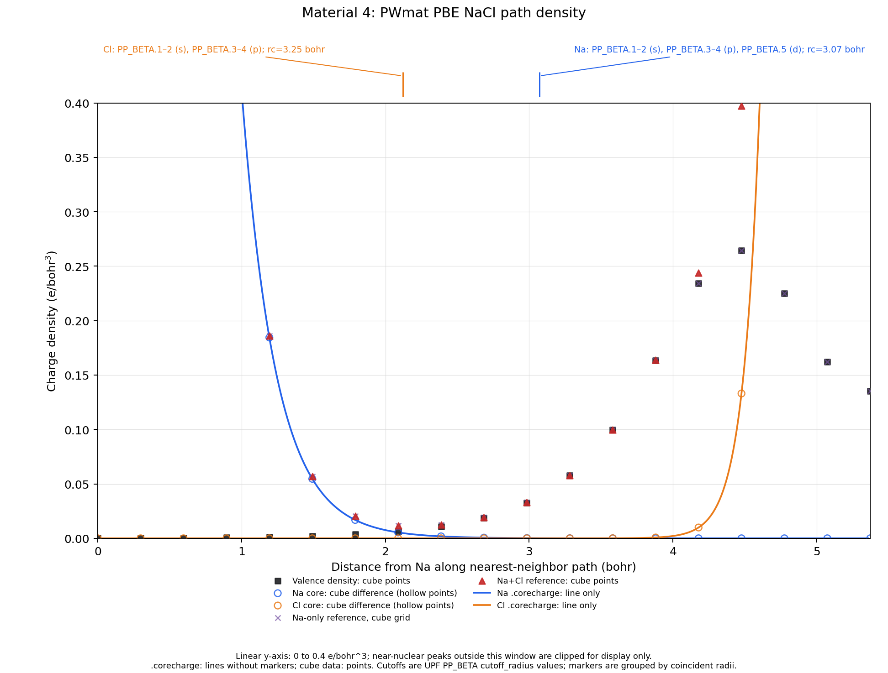

# NaCl Bader 参考实验

## 摘要

按 [实验提示词](../docs/NaCl-experiment-prompt.md) 重做了 NaCl Bader 实验。19 个规定条件全部成功生成 `ACF.dat`；为确认分析使用项目当前构建，另将 PWmat 的 12 个条件复跑一次，两轮结果逐字节一致。

核心现象得到复现：Na 赝势含 9 个价电子时，Na→Cl 转移量约为 0.86–0.87 e，加入芯密度参考在本算例上不改变划分；Na 仅含 1 个价电子时，直接分析给出约 1 e 的“完全转移”，加入全电子或 Na 芯参考后转移量降至约 0.81–0.83 e。

报告和完整证据保存在 `scratch/20261016-NaCl-redo-aa2e9a7d-FQjEePfv/`。两张路径图已复制到本项目 `assets/`；旧图 `assets/NaCl-density-path.png` 保留未覆盖。

## 环境与材料

实验时间为 2026-10-16（Asia/Shanghai），Git 基线为 `aa2e9a7d131f5c974f96e84f03f856065976f071`。使用的软件为：

- Henkelman `bader` 1.05（2023-08-19）；
- 项目 `build/convert_rho2cube.x`；
- 标量相对论 ONCVPSP 4.0.1（2019-03-01），成功输出补丁所需的 `!R` 数据；
- Python 3.10.14、NumPy 1.26.4 和 Matplotlib 3.9.2。

| 材料 | 输入与来源 | 程序、泛函、自旋、Na 价电子数 | 网格 |
| --- | --- | --- | --- |
| 1 | 官方 `NaCl.tar.gz` 中的 `NaCl/CHG_NaCl` | VASP 格式；Na 9；压缩包没有 `INCAR` / `POTCAR`，泛函与自旋不可核实 | $160^3$ |
| 2 | 官方 `NaCl_wcore.tar.gz` 中的 `CHGCAR`、`CHGCAR_sum` | VASP PBE，`ISPIN=2`；Na 1 | $120^3$ |
| 5 | `example/NaCl.VASP_Na9Cl7/CHGCAR`，参考由 `AECCAR0+AECCAR2` 生成 | VASP PBE；Na 9；本地没有 `INCAR` / `POTCAR`，自旋不可核实 | $48^3$ |
| 6 | `example/NaCl.VASP_Na1Cl7/CHGCAR`，参考由 `AECCAR0+AECCAR2` 生成 | VASP PBE；Na 1；本地没有 `INCAR` / `POTCAR`，自旋不可核实 | $36^3$ |
| 3 | `example/NaCl.SG15PBE/OUT.RHO` | PWmat PBE；Na 9；单通道 | $36^3$ |
| 8 | `example/NaCl.SG15PBE.SPIN2/OUT.RHO` 与 `OUT.RHO_2` | PWmat PBE；Na 9；`SPIN=2` | $36^3$ |
| 4 | `example/NaCl.zval1.SG15PBE/OUT.RHO` | PWmat PBE；Na 1；单通道 | $36^3$ |
| 7 | `example/NaCl.FHILDA/OUT.RHO` | PWmat LDA；Na 1；单通道 | $36^3$ |

两个官方示例包均从 Henkelman 官方 GitHub raw 地址下载，文件大小与哈希如下：

- `NaCl.tar.gz`：23,287,806 字节，SHA-256 `ba6a445d186558a1137037e2cb7641e2535eef935aaaf9ff1ed184b9fd608f00`；
- `NaCl_wcore.tar.gz`：32,260,196 字节，SHA-256 `c280e44d22da8811e3a61f33a7bbf601aabc7dfb760617b840ad0f5769245f06`。

官网压缩包地址遇到 TLS 失败后，改用提示词允许的官方 GitHub 来源。VTST scripts 页面读取返回 403，未能取得 `chgsum.pl`；所有联网请求及结果记在实验工作区的 `network-log.md`。

## 方法

每个晶胞含 4 个 Na 和 4 个 Cl。电荷转移量按下式计算：

$$
\Delta q_{\mathrm{Na}\rightarrow\mathrm{Cl}}
=z_{\mathrm{val}}(\mathrm{Na})
-\frac{1}{4}\sum_{i\in\mathrm{Na}}N_i^{\mathrm{Bader}}.
$$

同时用 Cl 的平均得电子量 $\overline{N}_\mathrm{Cl}-7$ 检查电荷守恒。`bader` 的积分文件始终是原始价电子密度；芯电子或全电子密度只通过 `-ref` 用作划分参考。

PWmat 四组材料分别生成 `rho.cube`、`rho.ref-na.cube` 和 `rho.ref-nacl.cube`，再执行直接、Na 芯参考和 Na+Cl 芯参考三种分析。材料 8 以权重 1 相加 `OUT.RHO`、`OUT.RHO_2`。VASP 材料 5、6 因官方求和脚本页面不可用，在实验目录实现了逐点求和；先验证两个 AECCAR 文件的结构头、网格和格点数量一致，再合并体密度区块。该 `CHGCAR_sum` 仅供本次 Bader 参考分析，不含末尾 PAW 占据信息，不用于 VASP 重启。

材料 3、4 的 PBE `.corecharge` 从相应 UPF 的嵌入 ONCVPSP 输入重跑生成。材料 7 的 FHI UPF 不含 `<PP_INPUTFILE>`，因此按本地材料中的电子组态手工构造 ONCVPSP 输入：Na 为 $1s^2 2s^2 2p^6$ 芯、$3s^1$ 价；Cl 为 $1s^2 2s^2 2p^6$ 芯、$3s^2 3p^5$ 价；两者均设 `iexc=3`。Na 的赝势阶段参数经调整后，程序成功输出 `!R`。它们只保证程序运行和提取芯密度，不复现原 FHI 赝势生成过程；所得密度是相同电子组态、价芯划分和 LDA 下重新计算的近似参考。

径向积分验证：PBE Na9 芯为 2.000012 e；PBE Na1、PBE Cl、LDA Na 和 LDA Cl 均为 10.000060 e/atom，与各自预期芯电子数一致。

## 电荷转移结果

每项结果按“Na→Cl 转移量 / Cl 平均得电子量；守恒差；Na 原子最大偏离均值”排列，单位为 e。完整未舍入结果及 ACF 总电子数见实验目录中的 `outputs/charge-transfer.tsv`。

| 材料 | 直接分析 | Na 芯参考 | Na+Cl 芯或全电子参考 |
| --- | --- | --- | --- |
| 1：Henkelman Na9 | 0.869037 / 0.869037；2.5e-7；7.5e-7 | — | 不适用 |
| 2：Henkelman Na1 | 0.999856 / 0.999856；2.5e-7；0 | — | 0.822415 / 0.822416；−2.5e-7；7.5e-7 |
| 5：VASP PBE Na9 | 0.866444 / 0.866360；8.4e-5；7.75e-6 | — | 0.866439 / 0.866355；8.4e-5；1.375e-5 |
| 6：VASP PBE Na1 | 0.999982 / 0.999984；−2.0e-6；0 | — | 0.808736 / 0.808737；−1.25e-6；7.5e-7 |
| 3：PWmat PBE Na9 | 0.862633 / 0.862553；8.0e-5；0 | 0.862633 / 0.862553；8.0e-5；0 | 0.862633 / 0.862553；8.0e-5；0 |
| 8：PWmat PBE Na9 SPIN2 | 0.862542 / 0.862463；7.9e-5；0 | 0.862542 / 0.862463；7.9e-5；0 | 0.862542 / 0.862463；7.9e-5；0 |
| 4：PWmat PBE Na1 | 1.000000 / 0.999965；3.5e-5；0 | 0.834483 / 0.834449；3.4e-5；0 | 0.834483 / 0.834449；3.4e-5；0 |
| 7：PWmat LDA Na1 | 1.000000 / 0.999993；7e-6；0 | 0.825432 / 0.825426；6e-6；0 | 0.825432 / 0.825426；6e-6；0 |

材料 5 最大等价 Na 离散为最大偏离 $1.375\times10^{-5}$ e、极差 $2.3\times10^{-5}$ e；其余 Na 离散不超过 $7.5\times10^{-7}$ e 或在 ACF 精度下为零。VASP Na9 的 ACF 总电荷比名义价电子数少约 $3.36\times10^{-4}$ e，转移量与 Cl 得电子量相差 $8.4\times10^{-5}$ e；其余差异也与 ACF 总电荷的积分误差一致。

官方示例结果用于分析完成后的核对：本次材料 1 直接结果和材料 2 全电子参考结果，逐原子电荷四舍五入到 4 位小数后均与压缩包自带 ACF 相符。不同版本输出列与精度略有差异。

## Na—Cl 路径电荷密度

路径沿周期边界上的最近邻 Na→Cl 方向，长 5.371092 bohr。cube 图点只取路径实际穿过的 19 个格点，不作插值；Na、Cl 芯密度格点值分别由 `rho.ref-na.cube-rho.cube` 和 `rho.ref-nacl.cube-rho.ref-na.cube` 得到，以空心散点表示。`.corecharge` 只用无标记实线，逐表读取原始数值并按表格顺序连接，没有重采样、平滑或拟合。两图均使用线性坐标，纵轴统一截取 **0–0.4 e/bohr³**，用于比较原子间价密度与芯密度尾部；两组 Cl 附近的价密度峰约为 0.264 e/bohr³，位于此范围内。超出显示范围的近核峰（包括材料 3 的近核价密度峰）被图框裁切，原始数据未改写。

图中上方的独立标记带避免覆盖数据，纵轴范围未为截断半径标记而改变。材料 3 的 Na `PP_BETA.1–2`（$s$）与 `.3–4`（$p$）均为 2.35 bohr，Cl 对应四个投影子均为 3.25 bohr；路径坐标标记分别为 Na 端 2.35 bohr、Cl 端 2.121092 bohr。材料 4 的 Na `PP_BETA.1–2`（$s$）、`.3–4`（$p$）和 `.5`（$d$）均为 3.07 bohr；Cl 四个投影子均为 3.25 bohr，路径标记为 3.07 bohr 与 2.121092 bohr。它们是 UPF 非局域投影子的 `cutoff_radius`，不是 ONCVPSP 输入 `rc` 或 `.corecharge` 尾部半径。

## 验证与限制

- 19 个指定条件均生成有效 `ACF.dat`，Bader 日志无错误。
- PWmat 原始密度积分分别为材料 3 的 63.99998792 e、材料 4 的 31.99999357 e、材料 7 的 31.99999454 e，以及材料 8 两通道的 32.00012213 e 和 31.99986581 e；均与预期价电子总数一致。
- 芯密度径向积分均与预期芯电子数一致；未使用参考密度自身的格点积分判断正确性。
- 材料 3、8 的三种划分结果相同；材料 4、7 的 Na 芯与 Na+Cl 芯参考结果相同。此现象只适用于本次材料和网格。
- 不能把不同材料间的差异归因于单一泛函、赝势、程序或网格因素；它们同时改变了多个计算条件。
- 材料 1 的压缩包缺少 `INCAR` / `POTCAR`，不能确认泛函和自旋设置；VASP 材料 5、6 也未提供这些元数据。
- 运行 PATH 中的转换器与项目当前 `build/` 文件哈希不同。本次用仓库当前构建重跑了 PWmat 的全部转换和分析，ACF 结果与首轮一致；建议实验报告记录实际二进制路径，避免误用旧安装。
- 官方 VTST scripts 页面不可读，项目工作流没有直接可用的 `chgsum.pl`。本次用实验内脚本完成等价逐点求和并通过 Bader 读取验证；脚本不应作为通用 VASP 文件写回工具。
- 材料 7 的 Na LDA 输入需要多次调整赝势阶段参数才能运行，相关失败现场保留在 scratch。提示词虽允许调整这些参数，但没有给出容易起步的例子。

## 联网操作记录

允许的联网操作为：Henkelman 官网 `NaCl.tar.gz` 下载失败（TLS EOF）；官网压缩包直读返回 403；官方 GitHub raw 的 `NaCl.tar.gz` 网页读取超时；Henkelman 官方 VTST scripts 页面读取返回 403；之后从官方 GitHub raw 成功下载 `NaCl.tar.gz` 和 `NaCl_wcore.tar.gz`，无重定向，文件大小与哈希见“环境与材料”。没有联网搜索，也没有访问第三方技术资料。逐请求时间、地址、结果和 curl 追踪见实验目录中的 `network-log.md`。
