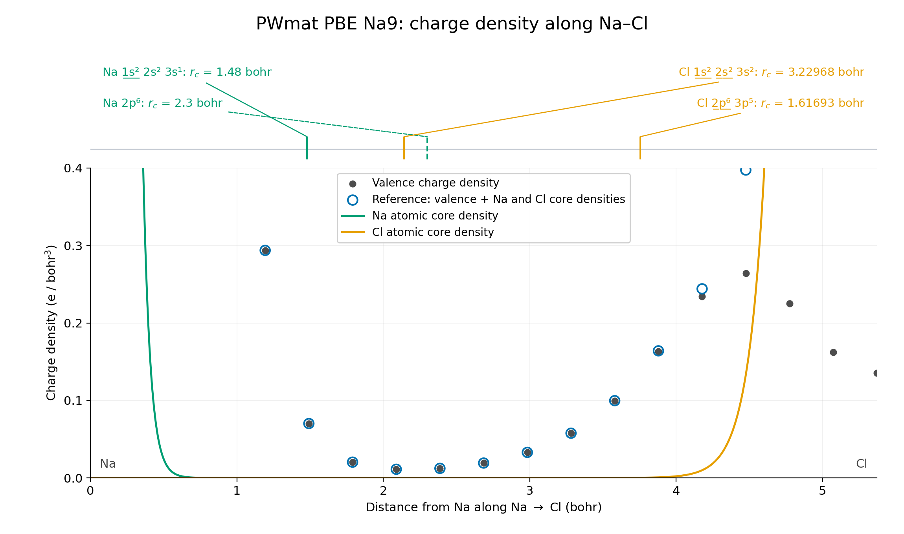
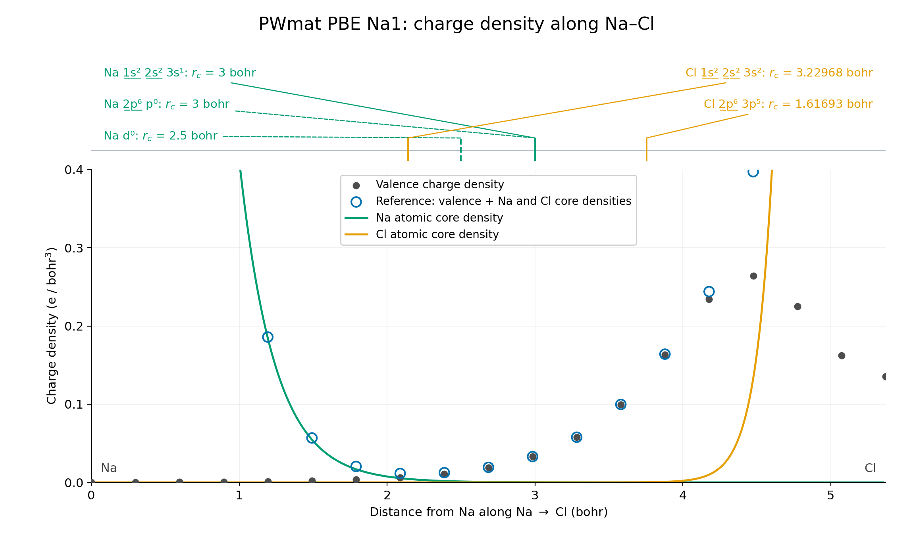

# NaCl Bader 参考实验

本项目提出在赝价电子电荷密度上叠加孤立原子芯电子电荷密度，作为 NCPP 计算中对 PAW 全电子参考密度的近似替代。本文以 NaCl 为例，检验该方法的可靠性。

## 方法

所有结果均使用 `bader` 1.05（2023-08-19），并显式指定 `-b weight` 算法。

### 电荷转移量

所有晶胞均含 4 个 Na 和 4 个 Cl。`ACF.dat` 的 `CHARGE` 列给出各 Bader 区域内的积分电子数，而非带正负号的净电荷。记第 $i$ 个 Na 的 Bader 区域内积分电子数为 $N_i$，则每个 Na 向 Cl 的平均电荷转移量定义为：

$$
\Delta q_{\mathrm{Na}\rightarrow\mathrm{Cl}}
=z_{\mathrm{val}}(\mathrm{Na})
-\frac{1}{4}\sum_{i\in\mathrm{Na}}N_i.
$$

其中，$z_{\mathrm{val}}(\mathrm{Na})$ 为 9 或 1。电荷转移量的单位为 e/Na，正值表示 Na 失去电子。

### 直接分析与参考划分分析

直接分析使用原始价电子电荷密度确定 Bader 区域，并对同一密度积分。指定 `-ref` 后，参考密度决定区域归属及边界格点的权重，而积分对象仍为原始价电子电荷密度。

VASP 的直接分析使用 `CHGCAR`，全电子密度参考为 `AECCAR0` 与 `AECCAR2` 的逐点和。PWmat 的原始电荷密度先转换为 `rho.cube`，再分别构造仅加入 Na 芯密度，以及同时加入 Na、Cl 芯密度的参考：

$$
\rho_{\mathrm{ref,Na}}=\rho_{\mathrm{val}}+\rho_{\mathrm{core,Na}},
\qquad
\rho_{\mathrm{ref,NaCl}}=\rho_{\mathrm{val}}+\rho_{\mathrm{core,Na}}+\rho_{\mathrm{core,Cl}}.
$$

Na9 的 Na 芯包含 2 个电子，Na1 和 Cl 的芯均包含 10 个电子。

芯密度表取自 ONCVPSP 4.0.1 的全电子原子计算。PBE 芯密度表使用相应 UPF 中记录的 ONCVPSP 输入生成。FHI LDA 数据的 UPF 不含这部分输入，因此所用芯密度是按相同价芯划分另行计算的参考。

格式转换、芯密度选项和具体命令见[程序与工具使用参考](../docs/code-usages.md)。

## 示例数据与计算设置

### PWmat

PWmat 示例包含以下四组数据：

| 目录 | 泛函与赝势 | Na 价电子数 | 自旋 | 电荷密度网格 |
| --- | --- | ---: | --- | --- |
| [`NaCl.SG15PBE`](../example/NaCl.SG15PBE/) | SG15 PBE | 9 | 非自旋极化 | $36^3$ |
| [`NaCl.SG15PBE.SPIN2`](../example/NaCl.SG15PBE.SPIN2/) | SG15 PBE | 9 | 共线自旋极化 | $36^3$ |
| [`NaCl.zval1.SG15PBE`](../example/NaCl.zval1.SG15PBE/) | Na zval1 ONCV PBE；Cl SG15 PBE | 1 | 非自旋极化 | $36^3$ |
| [`NaCl.FHILDA`](../example/NaCl.FHILDA/) | FHI LDA | 1 | 非自旋极化 | $36^3$ |

四组数据使用与 VASP 相同的八原子晶胞。`NaCl.SG15PBE.SPIN2` 的两个自旋通道相加后作为总电荷密度，其余三组各使用一个 `OUT.RHO`。

### VASP

自行计算的 VASP 数据保存在以下四个目录中：

| 目录 | Na 价电子数 | 电荷密度网格 | 用途 |
| --- | ---: | --- | --- |
| [`NaCl.VASP_Na9Cl7_48`](../example/NaCl.VASP_Na9Cl7_48/) | 9 | $48^3$ | 默认稀疏网格 |
| [`NaCl.VASP_Na9Cl7_160`](../example/NaCl.VASP_Na9Cl7_160/) | 9 | $160^3$ | 密网格，与 Henkelman Na9 的网格大小相同 |
| [`NaCl.VASP_Na1Cl7_36`](../example/NaCl.VASP_Na1Cl7_36/) | 1 | $36^3$ | 默认稀疏网格，本次重新计算的 PBE 数据 |
| [`NaCl.VASP_Na1Cl7_120`](../example/NaCl.VASP_Na1Cl7_120/) | 1 | $120^3$ | 密网格，与 Henkelman Na1 的网格大小相同 |

四组数据均使用 VASP 5.4.4、PBE 泛函和 `ISPIN=2`，采用晶格常数为 5.684526851 Å 的同一八原子晶胞，以及 4×4×4 的 Monkhorst–Pack k 点网格。Na9 和 Na1 的平面波截断能分别为 645.6 eV 和 262.5 eV。

## VASP 数据对比

在比较 VASP 与 PWmat 之前，先将自行计算的 VASP PBE 数据与 Henkelman 示例对照，以确认前者能否复现示例所展示的 Bader 划分特征，并考察二者的数值差异。Henkelman Na1 示例采用 PW91，Na9 示例则没有可用于核实泛函的输入；后文的主要 PWmat 对照采用 PBE。因此，后续比较选用自行计算的 VASP PBE 数据，以减少泛函差异的影响。

下表按 Na 价电子数列出六组数据。所有结果的单位均为 e/Na；“差值”定义为**自行计算结果减去同组 Henkelman 结果**，并在相同参考条件下比较。“—”表示不适用或缺少相应数据。

### Na9

| 数据 | 泛函 | 网格 | 直接分析 | 直接分析差值 | 全电子密度参考 |
| --- | --- | --- | ---: | ---: | ---: |
| Henkelman Na9 | —[^henkelman-na9-functional] | $160^3$ | 0.87353100 | 0.00000000 | — |
| 本工作，密网格 | PBE | $160^3$ | 0.88271250 | +0.00918150 | 0.88266750 |
| 本工作，默认网格 | PBE | $48^3$ | 0.87769725 | +0.00416625 | 0.87766025 |

[^henkelman-na9-functional]: Henkelman Na9 没有可用于核实泛函的输入。

### Na1

| 数据 | 泛函 | 网格 | 直接分析 | 直接分析差值 | 全电子密度参考 | 全电子密度参考差值 |
| --- | --- | --- | ---: | ---: | ---: | ---: |
| Henkelman Na1 | PW91 | $120^3$ | 0.99985300 | 0.00000000 | 0.82761900 | 0.00000000 |
| 本工作，密网格 | PBE | $120^3$ | 0.99385200 | −0.00600100 | 0.83027775 | +0.00265875 |
| 本工作，默认网格 | PBE | $36^3$ | 0.99458500 | −0.00526800 | 0.82413575 | −0.00348325 |

后续的 VASP 与 PWmat 对比采用自行计算的 PBE 默认网格数据。在相同网格下，本工作 PBE 数据与 Henkelman 示例的差异为 0.003–0.009 e/Na；其中 Na1 示例使用 PW91，Na9 示例的泛函不明。改变网格密度造成的差异为 0.001–0.006 e/Na。根据这些对照，本文将 0.01 e/Na 作为本实验的经验分辨率，不对这一量级内的差异作过度解读。

## VASP 与 PWmat

下表比较自行计算的 VASP 默认网格数据与四组 PWmat 数据所得的 Na→Cl 电荷转移量，单位为 e/Na。

| 数据 | 泛函 | Na 价电子数 | 网格 | 直接分析 | 仅 Na 芯密度参考 | Na、Cl 芯密度参考／全电子密度参考 |
| --- | --- | ---: | --- | ---: | ---: | ---: |
| VASP `NaCl.VASP_Na9Cl7_48` | PBE | 9 | $48^3$ | 0.87769725 | — | 0.87766025 |
| VASP `NaCl.VASP_Na1Cl7_36` | PBE | 1 | $36^3$ | 0.99458500 | — | 0.82413575 |
| PWmat `NaCl.SG15PBE` | PBE | 9 | $36^3$ | 0.88906500 | 0.88906500 | 0.88906500 |
| PWmat `NaCl.SG15PBE.SPIN2` | PBE | 9 | $36^3$ | 0.88894300 | 0.88894300 | 0.88894300 |
| PWmat `NaCl.zval1.SG15PBE` | PBE | 1 | $36^3$ | 1.00000000 | 0.85009300 | 0.85009300 |
| PWmat `NaCl.FHILDA` | LDA | 1 | $36^3$ | 1.00000000 | 0.84226300 | 0.84226300 |

VASP 最后一列以 `AECCAR0 + AECCAR2` 作为参考密度，PWmat 则以价电子电荷密度与孤立原子芯密度之和作为参考。

### 结果与讨论

1. **两组 PWmat Na9 PBE 数据可以归并。** `NaCl.SG15PBE` 与 `NaCl.SG15PBE.SPIN2` 分别采用非自旋极化和共线自旋极化计算。对于本例中的非磁性 NaCl，两种设置应收敛到同一物理状态；二者的 Na→Cl 电荷转移量相差不到 0.001 e/Na，远低于 0.010 e/Na 的经验分辨率。因此，后续分析以 `NaCl.SG15PBE` 作为 PWmat Na9 PBE 结果的代表。

2. **VASP 与 PWmat 的直接分析结果一致。** Na9 的结果分别为 0.878 e/Na 和 0.889 e/Na，相差约一个经验分辨率；Na1 的结果分别为 0.995 e/Na 和 1.000 e/Na，差异处于经验分辨率内。可以认为 VASP 和 PWmat 在直接分析下给出了相同的结果，遭遇相同的问题。

3. **Na9 无需修正。** VASP 加入全电子密度参考后，Na→Cl 电荷转移量的变化低于 0.001 e/Na；PWmat 加入芯密度参考后，结果在输出精度内不变。因此，Na9 已经将足够多的电子划为价电子，电荷转移量不会被全电子参考密度划分改变，其直接划分便是可靠结果。

4. **PWmat NCPP 芯密度叠加有效复现了 VASP 全电子参考对 Na1 的主要修正效果。** 两种方法分别将 Na→Cl 电荷转移量降低 0.170 e/Na 和 0.150 e/Na，修正后的结果为 0.824 e/Na 和 0.850 e/Na。可见，简单叠加孤立原子芯密度已经捕捉到近核密度对 Bader 划分的主要影响。两种结果仍相差 0.026 e/Na，超过本文的经验分辨率，因此芯密度叠加是有效的近似，但与全电子参考并不严格等价。

5. **Na9 有更多电荷转移。** Na9 中 Na 的电荷转移量均高于 Na1，我们认为这是因为 $2s$、$2p$ 实际也会参与自洽电子弛豫，贡献了电荷转移。

6. **本例只需加入 Na 芯密度。** 对 PWmat 数据，仅加入 Na 芯密度与同时加入 Na、Cl 芯密度所得的 Na→Cl 电荷转移量相同，只叠加 Na 芯电子密度便可获得良好的修正效果。

## Na—Cl 路径电荷密度分析

为了进一步解释上述修正效果，我们提取了 `NaCl.SG15PBE`（Na9）和 `NaCl.zval1.SG15PBE`（Na1）沿最近邻 Na—Cl 路径的电荷密度。路径连接 Na 与 Cl 的周期像，全长为 5.371 bohr，约合 2.842 Å。散点对应路径在 $36^3$ 网格上实际经过的 19 个格点，未经插值；径向芯密度曲线直接取自原始 `.corecharge` 表格。

图中的深灰色实心点表示原始价电子电荷密度，蓝色空心点表示叠加 Na、Cl 芯密度后的参考密度，绿色和橙色曲线分别表示孤立 Na 和 Cl 原子的径向芯密度。

图上方标出了赝势各角动量通道的赝化截断半径 $r_{c,l}$。这些数值取自 UPF 文件的 `<PP_INPUTFILE>`；本文将每个原子中心周围 $r<r_{c,l}$ 的区域称为该通道的芯区（*core region*），全电子波函数与赝波函数可能在其中存在差异。图中还列出了相应的芯态、占据价态和零占据散射态，下划线标出属于冻结芯的电子态。含芯电子的通道使用实线引线，不含芯电子的通道使用虚线引线；线型只表示该通道是否对芯密度有贡献，并不区分束缚态与散射态。

### Na9

### Na1

### 结果与讨论

1. **Na9 的芯密度不会显著改变 Bader 边界。** Na9 的 Na 芯仅包含两个高度局域的 $1s$ 电子，其芯密度在非常靠近原子核的位置便迅速衰减。沿 Na—Cl 路径，Na 芯密度的显著区域远离原子间的密度极小值；在该极小值附近，原始价电子电荷密度与参考密度基本重合。因此，叠加芯密度不会明显改变边界附近的密度梯度，这解释了 Na9 的直接分析与参考划分分析为何得到相同结果。

2. **Na1 的芯密度会影响 Bader 划分。** Na1 的芯包含较为延展的 $2s$、$2p$ 电子。加入 Na 芯密度后，Na 一侧乃至原子间区域的参考密度明显升高，边界附近的密度分布也随之改变。这与 Na1 加入参考密度后电荷转移量显著下降的结果一致。相比之下，Cl 的芯电子分布高度局域，在原子间边界附近的贡献可以忽略。因此，仅加入 Na 芯密度与同时加入 Na、Cl 芯密度所得的修正结果几乎相同。

3. **Na9 和 Na1 中两原子的芯区均有交叠。** Na9 的 Na $2p^6$ 与 Cl $3s^2$ 通道芯区发生交叠，Na1 的 Na $3s^1$ 与 Cl $3s^2$ 通道芯区也有明显交叠。[^pd04-core-region]

4. **“芯区很小且互不交叠”的假设不成立。** 上述交叠表明，[芯密度参考笔记](core-rho-correction.md)中“芯区足够小，不会侵入成键区域”的假设并不成立，因此其中提出的两种处理方法都需要重新审视。

   1. **所谓“简单且等效”的做法其实并不等效。** 叠加孤立原子芯密度只能补回冻结芯电子，不能恢复芯区内的全电子价密度。当芯区进入原子间区域并发生交叠时，被忽略的价电子重构可能改变边界附近的电荷密度及其梯度，进而移动 Bader 边界。因此，这种做法可以作为成本较低的近似，却不能视为与全电子重构严格等价。Na9 的结果表明，芯区交叠不一定会显著改变 Bader 边界，实际影响仍取决于边界附近的密度和梯度变化；Na1 的芯区交叠则可能是芯密度叠加结果与 VASP 全电子参考仍有差异的原因之一。

   2. **所谓“严格的做法”也存在问题。** 笔记中的公式仍将全电子重构写成彼此独立的单中心修正。模守恒条件只保证同一原子、同一角动量通道内的全电子波函数与赝波函数在相应芯区内具有相同范数，并不保证不同原子中心之间的交叠矩阵元在重构前后保持不变。各原子的芯区发生交叠后，重构波函数中还会出现不同原子中心修正项之间的交叉项。若把笔记中的重构写成 $|\psi_n^{\mathrm{rec}}\rangle=\hat T|\psi_n^{\mathrm{PS}}\rangle$，则

      $$
      \left\langle\psi_m^{\mathrm{rec}}\middle|\psi_n^{\mathrm{rec}}\right\rangle
      =\left\langle\psi_m^{\mathrm{PS}}\middle|\hat T^\dagger\hat T\middle|\psi_n^{\mathrm{PS}}\right\rangle,
      $$

      一般不再等于 $\delta_{mn}$。因此，该公式既没有保证重构轨道正交，也不能直接据此把重构密度写成这些轨道模方的简单求和；还需要一套能够正确处理交叉项和轨道交叠关系的完整重构方法。

[^pd04-core-region]: 这一结论针对本文采用的 SG15 赝势，并非所有 NCPP 都会出现芯区交叠。作为对照，PseudoDojo PD04 PBE 标量相对论的 [standard](https://github.com/PseudoDojo/ONCVPSP-PBE-PDv0.4/blob/master/standard.txt) 和 [stringent](https://github.com/PseudoDojo/ONCVPSP-PBE-PDv0.4/blob/master/stringent.txt) 表均选用 [`Na-sp`](https://github.com/PseudoDojo/ONCVPSP-PBE-PDv0.4/blob/master/Na/Na-sp.in) 与 [`Cl`](https://github.com/PseudoDojo/ONCVPSP-PBE-PDv0.4/blob/master/Cl/Cl.in) 赝势；其最大占据态截断半径之和为 3.10 bohr，小于 5.371 bohr 的 Na—Cl 最近邻距离，因此没有芯区交叠。

## 数据与复现

本实验共包含 23 个分析条件：VASP 8 个、PWmat 12 个、Henkelman 对照 3 个。所有分析均显式指定 `-b weight`，并生成了包含 8 个原子的有效 `ACF.dat`；运行日志中未发现错误。12 组 PWmat `.cube` 文件均由本项目的转换器生成。四组 VASP 示例的输入文件已经过哈希校验，参考密度也已逐点核对。

配套数据按用途整理如下：

- VASP 与 PWmat 的输入文件保存在 [`example/`](../example/) 中。
- [结果 TSV](data/NaCl-weight-results.tsv) 汇总了 23 个分析条件下的元素平均电子数、电荷转移量、积分守恒差和等价原子极差，并保留 `ACF.dat` 输出所支持的十进制位数。
- [结果 JSON](data/NaCl-weight-results.json) 保存了逐原子的 `ACF.dat` 原文、输入标识、参考密度构造方式、文件哈希及绘图记录。
- 路径格点保存在 [Na9 CSV](data/NaCl-path-Na9.csv) 和 [Na1 CSV](data/NaCl-path-Na1.csv) 中；径向芯密度分别保存在 [Na9](data/NaCl-core-Na9.csv)、[Na1](data/NaCl-core-Na1.csv) 和 [Cl](data/NaCl-core-Cl.csv) 三张 CSV 表中。[绘图脚本](data/plot_NaCl_paths.py) 使用这些数据生成配套图片，运行时需安装 NumPy 和 Matplotlib。
- Henkelman 对照来自官方发布的 [NaCl.tar.gz](https://theory.cm.utexas.edu/henkelman/code/bader/download/NaCl.tar.gz) 和 [NaCl_wcore.tar.gz](https://theory.cm.utexas.edu/henkelman/code/bader/download/NaCl_wcore.tar.gz)。
