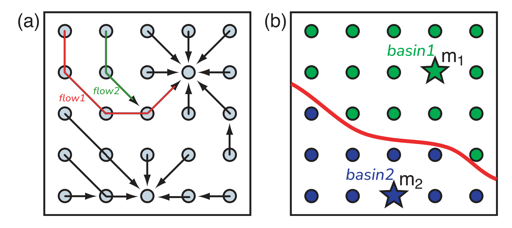
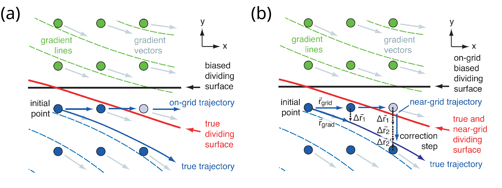

# Bader 程序使用说明

Bader 定义了一种利用电荷密度梯度流将分子划分为原子区域的方法，这种划分可用于电荷分析。
一些 DFT 软件将电荷密度表示为实空间均匀格点上的浮点数。Henkelman 针对这种数据形式，提出了一种高效的 Bader volume 划分算法。

该算法的实现程序 `bader` 可以在 [Henkelman 课题组网站](https://theory.cm.utexas.edu/henkelman/code/bader/)或 [GitHub](https://github.com/henkelmangroup/bader) 上找到。
课题组网站还提供源码和可执行文件下载、程序说明、输入示例、对 VASP 和 CASTEP 用户的提醒，以及论文列表。

本文结合论文和代码介绍该程序的用法，希望能对初次接触、不知如何使用它、面对程序参数踌躇不能行的读者有所帮助。
本文不会覆盖所有内容，但在 coding agent 时代，源码是最好的程序说明书（如果不能把源码作者抓来解说的话），你可以跟随自己的好奇心继续探索。

## 编译和安装

`bader` 的 Fortran 源码可以从[官网](https://theory.cm.utexas.edu/henkelman/code/bader/download/bader.tar.gz)或 [GitHub](https://github.com/henkelmangroup/bader) 下载；官网也提供可执行程序。

这个 Fortran 程序没有复杂的依赖。源码包提供了按平台和编译器区分的 `makefile.*` 文件，先选择适合你的环境的文件并复制为 `Makefile`，再在源码目录中运行：

```bash
make bader
```

即可在源码目录中生成 `bader` 可执行文件。

安装方式取决于你的目录组织习惯。我更喜欢：

```bash
PATH="$HOME/.local/bin:$PATH"
ln -s "$PWD/bader" "$HOME/.local/bin/bader"
```

这样，Linux 就能通过 `PATH` 环境变量找到 `bader`。
无论在安装还是使用中遇到问题，都可以试着向 LLM 大人求助。

### 尝试示例

bader 官网 examples 章节 和 [GitHub](https://github.com/henkelmangroup/bader/tree/main/examples) 都提供示例。每个示例压缩包通常包含电荷密度输入文件（如 `CHG_*`），以及 `bader` 的输出文件 `ACF.dat`、`BCF.dat` 和 `AVF.dat`。
解压后，进入示例目录（如 `C2H4a`），运行 `bader <chargefile>`（如 `bader CHG_C2H4a`），即可生成分析结果文件。结果可能因程序版本不同而与示例有所差异。

`NaCl_wcore` 比较特别：除了输入文件 `CHGCAR`，它还包含 `CHGCAR_sum`。后者是全电子电荷密度参考，在这个例子中，不使用 `-ref` 时，1个价电子的 Na 原子计算不会在 Na 附近形成密度峰，梯度流最终都汇流到 Cl 原子上；引入全电子参考密度后，Na 附近会分得一些电子数。

`CHGCAR_sum` 由以下步骤生成：

1. 在 `INCAR` 中设置 `LAECHG=.TRUE.`。
2. 运行 VASP，输出全电子电荷密度文件 `AECCAR0`、`AECCAR1` 和 `AECCAR2`。
3. 使用 Henkelman 提供的 [chgsum.pl](http://theory.cm.utexas.edu/vtsttools/scripts.html) 脚本，执行 `chgsum.pl AECCAR0 AECCAR2`，将两份密度相加。

将 `CHGCAR_sum` 作为“全电子”电荷密度参考，执行 `bader CHGCAR -ref CHGCAR_sum`，进行更可靠的空间划分和电荷积分。这时候会使用 `CHGCAR_sum` 进行空间划分，然后在该空间划分下使用 `CHGCAR` 进行电荷密度积分。
电荷划分结果可以与 `NaCl.tar.gz` 中的结果比较，后者来自 Na 原子有 9 个价电子的计算。


注意不建议直接运行 `bader CHGCAR_sum`：全电子电荷密度变化剧烈，`CHGCAR` 的实空间网格过于稀疏无法准确描述它，最直接的后果是对 `CHGCAR_sum` 作黎曼求和无法得到准确的全电子总数。

## 软件使用

### 直接使用

直接运行：

```bash
bader
```

会打印简短的使用说明。运行：

```bash
bader -h
```

则会给出各参数的详细说明。

分析电荷密度文件的最简单命令是：

```bash
bader <chargefile>
```

程序可以自动判断输入是 Gaussian 的 `.cube` 文件，还是 VASP 4 或 VASP 5 的 `CHGCAR` 文件。也可以显式指定输入格式：

```bash
bader <chargefile> -i <cube|chgcar>
```

一次运行 `bader` 涉及的所有电荷密度输入文件需使用相同格式。

```bash
bader <chargefile> -ref <reference_charge>
```

这条命令以 `<reference_charge>` 为参考划分 Bader volume，再用 `<chargefile>` 中的电荷密度进行积分。

### 选择例程（`-c` 和 `-n`）

`bader` 提供两种空间划分例程：

1. 以原子位置和电荷密度为参考的 Bader 划分例程。
2. 仅以原子位置为参考的 Voronoi 划分例程。

程序内部的布尔变量 `bader_flag` 和 `voronoi_flag` 分别控制这两个例程的开关。
`-c` 和 `-n` 分别将相应变量设为 `.true.` 和 `.false.`。

默认状态是：

```fortran
bader_flag = .true.
voronoi_flag = .false.
```

如果输入：

```bash
bader <chargefile> -n voronoi -c voronoi -c voronoi -n bader -c bader
```

最终状态是：

```fortran
bader_flag = .true.
voronoi_flag = .true.
```

Bader 划分是该程序的主要功能，几乎所有参数都围绕它设计，分析结果文件也只由 Bader 划分例程产生。
因此，本文将 Voronoi 划分视为附带功能，不再展开。

### 选择算法（`-b`）

`-b` 的选项有 `ongrid`、`neargrid` 和 `weight`。各算法对应的论文如下，具体介绍见后文。

|      论文     |   `-b` 选项   |
| :-----------: | :-----------: |
| Henkelman2006 |   `ongrid`    |
| Sanville2007  | ~~`offgrid`~~ |
|   Tang2009    |  `neargrid`   |
|    Yu2011     |   `weight`    |

- Henkelman2006 提出了原始的高效算法。
- Sanville2007 指出，原始算法会将真实的电荷密度梯度方向“吸附”到周围 26（$3^3-1$）个格点的方向上，其后果甚至使电荷转移分析结果依赖分子取向。他们提出的修正方法较为复杂，在当前代码中已弃用。
- Tang2009 在原始算法中引入一个修正矢量，简单、有效地解决了 Sanville2007 指出的问题。
- Yu2011 从更理论的角度出发推导算法，允许一个格点对应的体积元（voxel）按比例分属多个 *basin*。

算法选择上，推荐 `neargrid` 或 `weight`。

`neargrid` 是默认算法，计算快，修正方法简单、有效。但它的结果可能依赖格点的处理顺序，因此会在初步划分后调用边界归属复核（refine）子例程，重新判定边界格点属于哪个 *basin*。这里的边界格点，是指至少有一个近邻属于不同 *basin* 的格点。

`-r` 用于控制边界归属复核，其含义在历史版本中发生过多次变化：

- `-r N`：`N` 为正整数时，复核 `N` 次；早期版本中，`N=0` 表示关闭复核。
- `-r <-1|-2|auto>`：`auto` 被解析为 `-1`。两种方法都会逐轮复核，直到一轮中没有格点需要变更 *basin* 归属。区别在于，`-2` 每轮检查所有边界点，`-1` 则在后续轮次中只检查上一轮被重置格点的 $3\times3\times3$ 邻域。复核过程可能不收敛，此时可以改用 `-r N` 限制次数。
- 后来，`-r 0` 改为复核一次后退出。
- 在 1.05 版本中，代码强制只复核一次，因此 `-r -1` 和 `-r -2` 的区别也消失了。

默认的 `-m known` 让 *flow* 到达已有归属的格点后停止，这也是算法具有线性时间复杂度的原因。使用 `-m max` 后，*flow* 一直走到 *basin* 的极大值点才终止；这样一来使得划分结果不依赖划分过程，或许可以认为是 `-r <-1|-2|auto>` 的最终目标。

`weight` 的划分在数学上天然是唯一的，无需进行边界归属复核，不受上述格点方向“吸附”问题影响，但计算可能更耗时。

### 输出

除在标准输出（`stdout`）中显示计算进度外，`bader` 默认还会生成 `ACF.dat`、`BCF.dat` 和 `AVF.dat`：

- `ACF.dat`：按原子汇总 *Bader volume* 内的积分电子数，是用户通常最关心的文件。
- `BCF.dat`：按 *basin* 汇总信息。一个原子附近可能有多个密度极大值点，这在赝势计算中尤其常见，因为赝价电子的电荷密度很有可能在原子中心凹陷。程序先按极大值点划分 *basin*，再将各 *basin* 分配给最近的原子，并合并为该原子的 *Bader volume*。因此，`BCF.dat` 通常比 `ACF.dat` 有更多条数据。
- `AVF.dat`：记录每个原子包含哪些 *basin*，连接了上面两个文件中的数据条目。

文件详细信息可以参看[输出文件各列含义说明](#acfdatbcfdatavfdat-的各列含义)

#### `-p`：输出网格划分

> “我想看看 Bader volume 的表面。”

识别和绘制表面需要一些处理。不过，`bader` 为每个格点记录了原子和 *basin* 编号。你可以查看某个原子或 *basin* 包含哪些格点，通过它们占据的空间脑补表面的形状。

`-p` 控制两类数据的输出：格点所属的原子或 *basin* 编号，以及原子 *Bader volume* 或 *basin* 内的电荷密度。电荷密度文件在所选范围内保留输入密度，其余格点置零。

输出文件使用与输入相同的网格和文件格式。这些文件可能占用较多硬盘空间，只有通过 `-p` 明确指定时才会生成。

选项中的 `atom` 对应原子 *Bader volume*，即分配给同一原子的 *basin* 的合集；`bader` 对应单个 *basin*。本文介绍以下选项：

```text
-p <atom_index|bader_index>
-p <all_atom|all_bader>
-p <sel_atom|sel_bader> <volume list or range>
-p <sum_atom|sum_bader> <volume list or range>
```

|            选项             |    后续参数    |                    文件中的数值                     |            文件数量             |
| :-------------------------: | :------------: | :-------------------------------------------------: | :-----------------------------: |
| `atom_index`、`bader_index` |     不接受     |          每个格点所属的原子或 *basin* 编号          |            一个文件             |
|   `all_atom`、`all_bader`   |     不接受     |    各原子 *Bader volume* 或 *basin* 内的电荷密度    |   每个原子或 *basin* 一个文件   |
|   `sel_atom`、`sel_bader`   | 编号列表或范围 |   指定原子 *Bader volume* 或 *basin* 内的电荷密度   | 每个所选原子或 *basin* 一个文件 |
|   `sum_atom`、`sum_bader`   | 编号列表或范围 | 所选原子 *Bader volume* 或 *basin* 合集内的电荷密度 |            一个文件             |


以 `sel_atom` 为例，编号列表或范围参数的合法写法如下：

```text
-p sel_atom 1
-p sel_atom 1 3 5
-p sel_atom 1-3
```

以下参数写法会导致报错退出或运行时错误：

```text
-p sel_atom 1 2-3             
-p sel_atom 9-5               # 起点大于终点，未选中任何原子，程序报错退出
-p sel_atom 1-2 -p sel_atom 3 # 重复指定 sel_atom，对已分配的数组再次 allocate，触发运行时错误
```

> “如果运行 `bader CHGCAR -p sel_atom 1-3 -p all_atom -p sum_atom 4 8`，会发生什么？”

请看VCR：

```fortran
! bader/options_mod.f90：
    opts%print_sel_atom = .TRUE.
    opts%selanum        = 3
    ALLOCATE(opts%selavol(opts%selanum))
    opts%selavol        = [1, 2, 3]

    opts%print_all_atom = .TRUE.

    opts%print_sum_atom = .TRUE.
    opts%sumanum        = 2
    ALLOCATE(opts%sumavol(opts%sumanum))
    opts%sumavol        = [4, 8]

! bader/main.f90：
    IF (opts%print_all_bader)    CALL write_all_bader(bdr,opts,ions,chgval)
    IF (opts%print_all_atom)     CALL write_all_atom(bdr,opts,ions,chgval)
    IF (opts%print_sel_atom)     CALL write_sel_atom(bdr,opts,ions,chgval)
    IF (opts%print_sel_bader)    CALL write_sel_bader(bdr,opts,ions,chgval)
    IF (opts%print_sum_atom)     CALL write_sum_atom(bdr,opts,ions,chgval)
    IF (opts%print_sum_bader)    CALL write_sum_bader(bdr,opts,ions,chgval)
    IF (opts%print_bader_index)  CALL write_bader_index(bdr,opts,ions,chgval)
    IF (opts%print_atom_index)   CALL write_atom_index(bdr,opts,ions,chgval)
```

程序先输出所有原子的划分网格数据，再输出第 1–3 号原子的网格数据（覆盖同名文件），最后合并第 4、8 号原子的划分并输出。

## 算法

### 定义

坦率的说我还没弄明白 `bader` 源码中怎么定义 “bader volume”，本文的术语可能与 Henkelman 课题组的习惯有所不同。
因此，下面会先声明几个术语在本文中的含义（其中一些已经在前文出现）。



#### *flow*

按照 Bader 的定义，空间中的点沿电荷密度梯度流动，最终到达某个极大值点。本文将这条流线称为 *flow*。

对于离散网格，如上图（a），点只能在格点间移动，每一步选择近邻中电荷密度上升最快的方向。当所有近邻的密度都不再上升时，移动停止。得到的折线（如图（a）中的 `flow1`）就是离散网格上的 *flow*。

后续 *flow* 不必一直走到极大值点：一旦进入已有 *flow* 的路径，就可以继承其最终归属，如图（a）中的 `flow2`。

#### *basin*

当所有点都知道自己最终会流向哪个极大值点时，我们就完成了空间网格的划分。

本文将每个区域称为 *basin*，意为流汇聚的地方。嗯，水往低处流，但这里的 *flow* 往高处流。

#### *Bader volume*（原子区域）

极大值点可能多于原子。程序需要确定每个 *basin* 属于哪个原子，再合并属于同一原子的 *basin*；本文将合并后的区域称为该原子的 *Bader volume*[^badervolume]。

[^badervolume]: Henkelman 课题组语境中的 *Bader volume* 大致对应本文使用的 *basin*。

### [Henkelman2006](https://doi.org/10.1016/j.commatsci.2005.04.010)

下面我们从 Henkelman2006 的算法开始介绍。
哦，上面的定义已经把算法讲完了。

由于每个格点基本只处理一次，计算时间随格点数量线性增长，这是一个很高效的算法。

移动方向只能从 26 个方向中选择，真实梯度方向会“吸附”到这些方向上。[Sanville2007](https://doi.org/10.1002/jcc.20575) 指出，这种离散化与格点移动方式会带来较大的电荷积分误差，使分子的 Bader 电荷分析结果依赖分子取向。
这种取向依赖并不符合物理，增加网格密度也无法有效消除它。官网提供的 `C2H4a`、`C2H4b` 两个示例展示了这一问题。

### [Tang2009](https://doi.org/10.1088/0953-8984/21/8/084204)



图（a）展示了原始算法因移动方向“吸附”而导致的 *basin* 划分错误，图（b）展示了 Tang2009 的修正方法。
格点移动时，同时记录梯度步矢量 $\vec{r}_\text{grad}$ 与格点步矢量 $\vec{r}_\text{grid}$ 之间的偏离矢量，第一步后为 $\Delta\vec{r}=\Delta\vec{r}_1$。
每次移动都累加偏离矢量，如第二步后有 $\Delta\vec{r}=\Delta\vec{r}_1+\Delta\vec{r}_2$。当累积偏离量足够大时，就执行修正步（correction step），调整移动位置，并更新偏离矢量为 $\Delta\vec{r}={\Delta\vec{r}_2}'$。

这样，虽然仍在格点间移动，路径却能更接近真实的电荷密度梯度流线。

不过，每条 *flow* 的偏离量都从 0 开始累积，因此结果可能依赖起始格点和处理顺序，划分结果并不唯一，也不一定是最佳结果。算法会在 *basin* 划分完成后复核（refine）边界格点的归属，以缓解这一问题。

### [Yu2011](https://doi.org/10.1063/1.3553716)

该论文从更理论的角度出发，考察初始时均匀分布在一个 voxel 内的点，沿电荷密度梯度流动后会到达哪些极大值点。
从连续空间到离散格点的离散化过程中，格点之间的流量对应于 Voronoi 剖分所得 voxel 多面体公共面的通量。

在这个定义下，一个格点不必完全属于单一 *basin*，而可以按流量比例分属多个 *basin*。引入归属权重后，可以唯一确定划分。
分析离散化中的近似，还可以确定 Bader 电荷积分误差对网格间距的收敛阶数。该算法也容易扩展到非均匀网格。

算法先将格点按电荷密度从高到低排序，再依次处理。每个格点只需考虑密度比自己高的邻点，在依次处理的过程中，由于这些高邻点先于当前格点处理，归属信息可以自然地从各 *basin* 的极大值点出发，逐步向低密度格点传播。也具有（准）线性复杂度，非常妙。

> 上面是帮助快速建立理解的说法。严肃地说，本算法实现的实际程序是
> 1. 第一次从高到低搜寻，可以识别极大值点，并自然地确定每个格点向近邻密度上升格点的权重转移比例
> 2. 后续用 *basin* 次重复搜寻，确定每个格点归属于各个 *basin* 的权重。
> 
> 随着体系增大，*basin* 数量 $B$ 和格点数量 $N$ 通常都会增加。这份程序实现对每个 *basin* 都扫描一遍全部格点以确定权重，时间复杂度应为 $O(N \log N+BN) > O(N)$；空间复杂度为 $O(N)$。
> 但是依旧非常妙。

## `ACF.dat`、`BCF.dat`、`AVF.dat` 的各列含义

以下说明对应 `bader` 1.05 中的输出例程 `bader_mod.f90` 的 `bader_output`。
`ACF.dat` 按原子汇总，`BCF.dat` 按 *basin* 列出，`AVF.dat` 记录原子与 *basin* 的对应关系。

### `ACF.dat`

|  列   |     表头     |                        含义                        |
| :---: | :----------: | :------------------------------------------------: |
|   1   |     `#`      |   原子编号，从 1 开始，与输入文件的原子顺序一致    |
|  2–4  |   `X Y Z`    |                  原子的笛卡尔坐标                  |
|   5   |   `CHARGE`   |    分配给该原子的所有 *basin* 中的电荷密度积分     |
|   6   |  `MIN DIST`  | 原子到其所属区域边界格点的最短距离，考虑周期性边界 |
|   7   | `ATOMIC VOL` |        分配给该原子的所有 *basin* 的总体积         |

`CHARGE` 是输入电荷密度的积分结果，即“Bader charge”量，并非原子的电荷转移量。`bader` 本身不知道每个原子的价电子数量。

### `BCF.dat`

|  列   |    表头    |                         含义                         |
| :---: | :--------: | :--------------------------------------------------: |
|   1   |    `#`     |               *basin* 序号，从 1 开始                |
|  2–4  |  `X Y Z`   |        该 *basin* 的密度极大值点的笛卡尔坐标         |
|   5   |  `CHARGE`  |              该 *basin* 内的积分电子数               |
|   6   |   `ATOM`   | 该 *basin* 被分配给的原子编号，对应 `ACF.dat` 第一列 |
|   7   | `DISTANCE` |             该极大值点到所分配原子的距离             |

### `AVF.dat`

|   部分   | 表头或内容  |                         含义                         |
| :------: | :---------: | :--------------------------------------------------: |
|  第一项  |   `Atom`    |           原子编号，对应 `ACF.dat` 第一列            |
|  分隔符  |    `...`    |                          -                           |
| 后续各项 | `Volume(s)` | 属于该原子的 *basin* 编号列表，对应 `BCF.dat` 第一列 |

```text
   Atom                     Volume(s)
     5   ...       6    7    8    9
```

没有 *basin* 被分配给的原子不会出现在这个文件中，`-p all_atom`、`-p all_bader` 的输出也会受此影响。

### 输出数值单位受输入文件影响

|     量     | 标准 VASP `CHGCAR` 输入 | 标准 Gaussian `.cube` 输入 |
| :--------: | :---------------------: | :------------------------: |
| 坐标与距离 |            Å            |            bohr            |
|    体积    |           ų            |           bohr³            |
|  `CHARGE`  |         电子数          |           电子数           |
